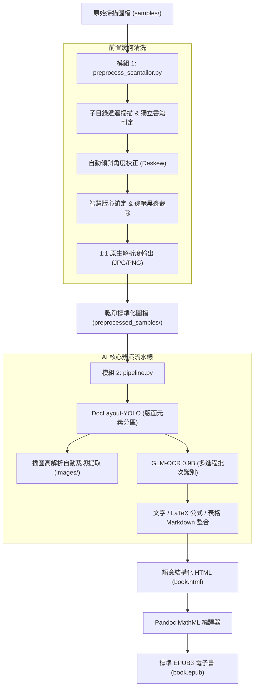

# ScanORC: 掃描書本轉語意結構化 HTML / EPUB 全流程數位化系統

[](https://www.python.org/)
[](https://pytorch.org/)
[](LICENSE)
[](https://developer.nvidia.com/cuda-zone)

**ScanORC** 是一套專為紙本書籍掃描檔打造的現代化端到端數位化流水線。系統整合了出版級幾何預處理引擎與最新的輕量級視覺語言模型（VLM），將傾斜、留白不均、帶有陰影的掃描圖檔，自動轉換為包含**原生高解析插圖**、**LaTeX/MathML 數學公式**與**結構化 Markdown 表格**的標準 HTML5 與 EPUB3 電子書。

---

## 🌟 核心特色

1. **出版級幾何轉正與去邊 (`preprocess_scantailor.py`)**：
   - **多階層子目錄遞迴**：自動遞迴掃描輸入目錄結構，並以完全相同的目錄樹鏡像輸出。
   - **獨立書籍版面判定**：每個子目錄視為一本獨立書籍，自動重新計算版心與轉正角度，絕不跨目錄沿用或殘留規格。
   - **1:1 原生尺寸無損輸出**：預設不進行任何圖形重新取樣或縮放，完整保留原始掃描之最高清晰度；支援自訂 `--dpi`。
   - **自動去除黑邊與雜訊**：自動清除掃描儀壓痕黑邊、書脊中縫漸層陰影與微小孤立黑點（Despeckle）。

2. **精準版面分析與內容分離 (`DocLayout-YOLO`)**：
   - 採用以 YOLOv10 為基礎之出版版面偵測模型（39MB 超輕量）。
   - 智慧區分正文段落、標題、頁眉頁腳、表格、行內/行間數學公式、插圖與圖說文字。
   - 自動將非文字內容（插圖）無損裁切儲存為獨立高解析圖檔並關聯至文章中。

3. **強大視覺語言 OCR (`GLM-OCR 0.9B`)**：
   - 智譜開源 0.9B 多模態端到端模型，具備深厚的繁簡中文、排版與公式理解力。
   - 自動識別繁體中文、複雜排版表格並還原為標準 Markdown Table。
   - 數學公式自動識別並輸出為標準 LaTeX 語法（`$...$` 與 `$$...$$`）。

4. **標準 MathML EPUB 產出 (`Pandoc`)**：
   - 一鍵打包標準 EPUB3 電子書與獨立響應式 HTML5。
   - 透過 Pandoc 數學引擎（`-f html+tex_math_dollars --mathml`），將 LaTeX 公式直接轉譯為現代電子書閱讀器原生支援的 **MathML 向量數學公式**，支援任意縮放不失真。

5. **多進程與批次並行加速**：
   - 支援單頁區塊批次推理 (`--batch-size`)。
   - 支援多進程獨立 Worker 並行 (`--workers`)，充分壓榨多核心 CPU 與大容量顯卡（如 16GB RTX 5060 Ti / 4080）算力。

---

## 🏗️ 系統運作流程 (Workflow)



---

## 📦 系統需求與環境安裝

### 1. 系統相依套件

* **作業系統**：Linux (Ubuntu 20.04+, Debian, Arch, Fedora)
* **硬體需求**：
  * **最低配置**：4GB VRAM NVIDIA GPU（如 RTX 3050 / GTX 1650），可使用 `--batch-size 2 --workers 1`。
  * **推薦配置**：16GB VRAM NVIDIA GPU（如 RTX 5060 Ti / 4080），可使用 `--batch-size 4 --workers 4` 獲得 3~4 倍並行加速。
* **外掛系統工具**：
  * **Pandoc**：用於編譯 MathML EPUB。
    ```bash
    sudo apt update && sudo apt install -y pandoc
    ```
  * **ScanTailor-CLI**：用於出版級幾何轉正。建議透過 Flatpak 安裝：
    ```bash
    flatpak install flathub org.scantailor.ScanTailor
    ```
    *(本系統會自動偵測系統 PATH 內的原生 `scantailor-cli` 或 Flatpak 版 `org.scantailor.ScanTailor`)*

---

### 2. 建立 Python 虛擬環境

建議使用 Python 3.10 或 3.11：

```bash
# 複製專案
git clone https://github.com/your-username/scanorc.git
cd scanorc

# 建立並啟用虛擬環境
python3 -m venv .venv
source .venv/bin/activate

# 安裝 PyTorch (CUDA 12.4 版本)
pip install torch torchvision --index-url https://download.pytorch.org/whl/cu124

# 安裝專案相依套件
pip install -r requirements.txt
```

---

### 3. 下載 AI 模型權重

本專案提供自動下載腳本，自動從 HuggingFace 取得 DocLayout-YOLO 與 GLM-OCR 模型權重：

```bash
python download_models.py
```
模型將自動下載至：
* `models/doclayout_yolo/` (~39MB)
* `models/glm-ocr/` (~2.5GB)

---

## 🚀 快速上手 (Quick Start)

### 步驟 1：執行前置轉正與留白裁切

將掃描圖檔放置於 `samples/`（支援任意層級之子目錄結構，例如 `samples/書名/章節/`）：

```bash
# 預設執行：各目錄獨立判定，1:1 原生尺寸輸出
python preprocess_scantailor.py --input samples --output preprocessed_samples
```

### 步驟 2：執行 AI 版面分析、OCR 與 EPUB 生成

```bash
# 單 Worker 基礎執行 (適合 4GB~8GB VRAM)
python pipeline.py --samples preprocessed_samples --output output --batch-size 2 --workers 1 --epub

# 4 Worker 多進程極速並行 (適合 16GB VRAM，如 RTX 5060 Ti)
python pipeline.py --samples preprocessed_samples --output output --batch-size 4 --workers 4 --epub
```

產出結果位於 `output/`：
* `output/book.html`：結構化 HTML5（內嵌 KaTeX 數學渲染與響應式排版）。
* `output/book.epub`：標準電子書（含章節目錄、內嵌圖片與原生向量 MathML 公式）。
* `output/images/`：從版面中自動裁切出的高解析插圖。

---

## ⚙️ 詳細指令參數說明

### 1. `preprocess_scantailor.py`（前置處理引擎）

| 參數 | 簡寫 | 預設值 | 說明 |
| :--- | :---: | :---: | :--- |
| `--input` | `-i` | `samples` | 輸入來源路徑（單張圖檔或包含掃描檔的目錄，支援遞迴子目錄） |
| `--output` | `-o` | `preprocessed_samples` | 輸出目錄（自動鏡像建立相同的子目錄結構） |
| `--format` | `-f` | `jpg` | 最終圖檔格式，可選：`jpg`、`png`、`tif` |
| `--dpi` | - | `None` | 輸出解析度 DPI（**預設 None 不縮放，保持 1:1 原生像素**；指定時才執行重新取樣） |
| `--margins` | - | `10` | 版心四周均勻邊距大小 (單位: mm) |
| `--color-mode` | - | `color_grayscale` | 色彩模式：`color_grayscale` (保留插圖/照片階調)、`mixed`、`black_and_white` |
| `--despeckle` | - | `normal` | 去雜點強度：`normal`、`cautious`、`aggressive`、`off` |
| `--quality` | - | `95` | JPG 輸出壓縮品質 (1~100) |
| `--batch-size` | - | `0` | 單一目錄分批大小 (預設 0 表示整章節一次性處理以維持版心尺寸統一) |

---

### 2. `pipeline.py`（AI 核心辨識流水線）

| 參數 | 預設值 | 說明 |
| :--- | :---: | :--- |
| `--samples` | `samples` | 待處理圖檔目錄或單一圖檔路徑 |
| `--output` | `output` | 成果儲存目錄（產出 HTML、EPUB 與裁切圖片） |
| `--title` | `數位化掃描書本` | 書名 / 文件標題（將寫入 EPUB Metadata） |
| `--epub` | `False` | 是否在生成 HTML 後自動調用 Pandoc 編譯 MathML EPUB |
| `--batch-size` | `2` | 單頁內 OCR 區塊批次大小（建議：4GB 顯卡設 2；16GB 顯卡可設 4~8） |
| `--workers` | `1` | 並行處理 Worker 進程數（建議：4GB 顯卡設 1；16GB 顯卡設 3~4） |

---

## 📊 硬體資源與顯存 (VRAM) 調優建議

GLM-OCR 0.9B 模型在 FP16 精度下單個實例基準佔用約 **2.1 GB VRAM**。

| 顯卡規格 | 建議設定 | 預期總 VRAM 佔用 | 吞吐速度 (400 頁書) |
| :--- | :--- | :---: | :---: |
| **4GB ~ 6GB** (RTX 3050/2060) | `--workers 1 --batch-size 2` | ~ 2.2 GB | ~ 40~50 分鐘 |
| **8GB** (RTX 3070/4060) | `--workers 2 --batch-size 2` | ~ 4.4 GB | ~ 22~28 分鐘 |
| **16GB** (RTX 5060 Ti / 4080) | `--workers 4 --batch-size 4` | ~ 9.0 ~ 10.5 GB | **~ 10~15 分鐘** (加速 3.5×) |

> [!TIP]
> 在 16GB 顯卡環境下，**增加 `--workers`（多進程並行處理多頁）的加速效果遠大於僅加大單頁 `--batch-size`**。因為多進程能同時並行 DocLayout-YOLO 檢測、GLM-OCR 批次推理與 CPU 圖片前處理，達到最大化 GPU 算力利用率。

---

## 📂 專案檔案結構

```text
scanorc/
├── .gitignore               # Git 忽略設定 (排除大型權重與快取)
├── LICENSE                  # MIT 授權條款
├── README.md                # 專案詳細說明文件
├── requirements.txt         # Python 套件清單
├── download_models.py       # 自動下載 HuggingFace 模型權重
├── preprocess_scantailor.py # 出版級轉正、留白裁切與版心標準化前處理引擎
├── pipeline.py              # DocLayout-YOLO + GLM-OCR 端到端轉換流水線
├── samples/                 # 預設範例掃描圖片目錄 (含測試樣張)
├── models/                  # [Ignored] AI 模型權重目錄 (執行 download_models.py 後生成)
│   ├── doclayout_yolo/      # DocLayout-YOLO 權重 (YOLOv10)
│   └── glm-ocr/             # GLM-OCR 0.9B 視覺語言模型
└── output/                  # [Ignored] 預設轉換產物輸出目錄
    ├── book.html            # 語意 HTML5
    ├── book.epub            # MathML EPUB3 電子書
    └── images/              # 自動提取之插圖
```

---

## 📄 授權條款 (License)

本專案基於 [MIT License](LICENSE) 條款開放開源。所依賴之模型依其原創作者條款使用：
* **DocLayout-YOLO**：基於 Apache-2.0 授權。
* **GLM-OCR**：基於 Apache-2.0 授權。
* **ScanTailor**：基於 GPLv3 授權。
