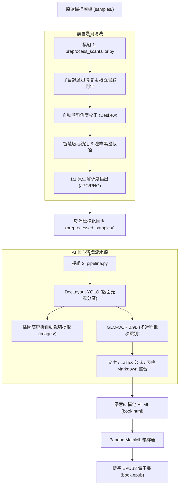

# ScanORC: 掃描書本轉語意結構化 HTML / EPUB 全流程數位化系統

[](https://www.python.org/)
[](https://pytorch.org/)
[](LICENSE)
[](https://developer.nvidia.com/cuda-zone)

**ScanORC** 是一套專為紙本書籍掃描檔打造的現代化端到端數位化流水線。系統整合了出版級幾何預處理引擎與最新的輕量級視覺語言模型（VLM），將傾斜、留白不均、帶有陰影的掃描圖檔，自動轉換為包含**原生高解析插圖**、**LaTeX/MathML 數學公式**與**結構化 Markdown 表格**的標準 HTML5 與 EPUB3 電子書。

---

## 🌟 核心特色

1. **出版級幾何轉正與去邊 (`preprocess_scantailor.py`)**：
   - **多階層子目錄遞迴**：自動遞迴掃描輸入目錄結構，並以完全相同的目錄樹鏡像輸出。
   - **獨立書籍版面判定**：每個子目錄視為一本獨立書籍，自動重新計算版心與轉正角度，絕不跨目錄沿用或殘留規格。
   - **1:1 原生尺寸無損輸出**：預設不進行任何圖形重新取樣或縮放，完整保留原始掃描之最高清晰度；支援自訂 `--dpi`。
   - **自動去除黑邊與雜訊**：自動清除掃描儀壓痕黑邊、書脊中縫漸層陰影與微小孤立黑點（Despeckle）。

2. **精準版面分析與內容分離 (`DocLayout-YOLO`)**：
   - 採用以 YOLOv10 為基礎之出版版面偵測模型（39MB 超輕量）。
   - 智慧區分正文段落、標題、頁眉頁腳、表格、行內/行間數學公式、插圖與圖說文字。
   - 自動將非文字內容（插圖）無損裁切儲存為獨立高解析圖檔並關聯至文章中。

3. **強大視覺語言 OCR (`GLM-OCR 0.9B`)**：
   - 智譜開源 0.9B 多模態端到端模型，具備深厚的繁簡中文、排版與公式理解力。
   - 自動識別繁體中文、複雜排版表格並還原為標準 Markdown Table。
   - 數學公式自動識別並輸出為標準 LaTeX 語法（`$...$` 與 `$$...$$`）。

4. **標準 MathML EPUB 產出 (`Pandoc`)**：
   - 一鍵打包標準 EPUB3 電子書與獨立響應式 HTML5。
   - 透過 Pandoc 數學引擎（`-f html+tex_math_dollars --mathml`），將 LaTeX 公式直接轉譯為現代電子書閱讀器原生支援的 **MathML 向量數學公式**，支援任意縮放不失真。

5. **多進程與批次並行加速**：
   - 支援單頁區塊批次推理 (`--batch-size`)。
   - 支援多進程獨立 Worker 並行 (`--workers`)，充分壓榨多核心 CPU 與大容量顯卡（如 16GB RTX 5060 Ti / 4080）算力。

6. **微創頁面修復與秒級重新編譯 (`patch_pages.py`)**：
   - 產出 HTML/EPUB 後，若人工檢查發現特定幾頁辨識不良或過於複雜，可直接指定檔名或頁碼將該頁替換為原始高解析圖檔。
   - 完整保留原頁面 id 與目錄跳轉錨點，並自動調用 Pandoc 在 **1~2 秒內**重新編譯完成最新 EPUB，徹底免除重跑數十分鐘全書 OCR 的時間成本。

7. **全功能視覺化控制台 (`app_gui.py`)**：
   - 基於 PySide6 打造，提供完整分步頁籤（轉正 $\rightarrow$ 目錄抽取 $\rightarrow$ AI 辨識 $\rightarrow$ 章節歸檔 $\rightarrow$ 微創修復）與「一鍵端到端總控」。
   - 內建智慧檔案清單與標記機制，所有參數可視化即時調整，並同步預覽與複製對應之 CLI 終端指令。
   - 非同步進程通訊，即時串流終端日誌，底層 Python 腳本 100% 解耦保留，可隨時於終端機單獨使用。

---

## 🏗️ 系統運作流程 (Workflow)



---

## 📦 系統需求與環境安裝

### 1. 系統相依套件

* **作業系統**：Linux (Ubuntu 20.04+, Debian, Arch, Fedora)
* **硬體需求**：
  * **最低配置**：4GB VRAM NVIDIA GPU（如 RTX 3050 / GTX 1650），可使用 `--batch-size 2 --workers 1`。
  * **推薦配置**：16GB VRAM NVIDIA GPU（如 RTX 5060 Ti / 4080），可使用 `--batch-size 4 --workers 4` 獲得 3~4 倍並行加速。
* **外掛系統工具**：
  * **Pandoc**：用於編譯 MathML EPUB。
    ```bash
    sudo apt update && sudo apt install -y pandoc
    ```
  * **ScanTailor-CLI（免安裝，專案已內建）**：
    本專案已自帶免安裝的 Portable 版 `bin/scantailor-cli` 與專屬執行環境（x86_64 Linux），**無需額外安裝任何系統套件或 Flatpak**，Clone 後立即可直接執行！
    *(系統若已安裝原生 `scantailor-cli` 或 Flatpak 版亦可自動備援偵測)*

---

### 2. 建立 Python 虛擬環境

建議使用 Python 3.10 或 3.11：

```bash
# 複製專案
git clone https://github.com/your-username/scanorc.git
cd scanorc

# 建立並啟用虛擬環境
python3 -m venv .venv
source .venv/bin/activate

# 安裝 PyTorch (CUDA 12.4 版本)
pip install torch torchvision --index-url https://download.pytorch.org/whl/cu124

# 安裝專案相依套件
pip install -r requirements.txt
```

---

### 3. 下載 AI 模型權重

本專案提供自動下載腳本，自動從 HuggingFace 取得 DocLayout-YOLO 與 GLM-OCR 模型權重：

```bash
python download_models.py
```
模型將自動下載至：
* `models/doclayout_yolo/` (~39MB)
* `models/glm-ocr/` (~2.5GB)

---

## 🚀 快速上手 (Quick Start)

### 方式 0：PySide6 桌面視覺化控制台（圖形介面，推薦初學者與視覺化操作）

若偏好圖形介面，可直接啟動內建的桌面控制台：

```bash
python app_gui.py
```

* **左側檔案清單**：支援一鍵匯入目錄或圖檔，勾選標記 `[TOC 目錄頁]`、`[略過 OCR]` 與 `[Patch 修復目標]`，自動連動到各步驟參數。
* **分頁工作區**：
  * **🚀 一鍵端到端總控**：自動執行轉正 $\rightarrow$ 目錄抽取 $\rightarrow$ AI 辨識 $\rightarrow$ 章節歸檔全流程。
  * **📐 步驟 1**：幾何轉正與裁切設定。
  * **📑 步驟 2**：目錄抽取（內建 JSON 檢視與即時編輯儲存）。
  * **🤖 步驟 3**：AI 版面與 EPUB 生成（支援即時開啟成果）。
  * **📁 步驟 4**：章節目錄歸檔（移動或複製）。
  * **🩹 步驟 5**：頁面微創替換（支援 `--list` 狀態檢視與一鍵 `--revert` 還原）。
* **即時 CLI 指令預覽**：調整任何參數時，介面即時產生對應之終端機指令並支援一鍵複製。
* **即時終端輸出**：非同步串流顯示日誌，支援進度條與隨時中斷任務。

---

### 方式 A：終端機一鍵端到端自動化處理（命令列推薦）

從只有原始圖檔（`Cover-xx.jpg` 與 `Page-xxx.jpg`）的目錄開始，一鍵完成：**轉正去邊裁切 $\rightarrow$ 目錄抽取 $\rightarrow$ HTML/EPUB 生成 $\rightarrow$ 章節目錄歸檔**：

```bash
# 一鍵全流程執行 (自動完成全套處理，生成 HTML 與 EPUB，並將圖檔分章歸檔)
python process_book.py --input samples --output output --workers 4

# 若有部分純圖片頁或難以辨識的頁面，可指定跳過 OCR 直接嵌入原圖：
python process_book.py --input samples --output output --skip-ocr Page-050.jpg Page-060.jpg
```

---

### 方式 B：分步獨立執行（進階客製）

#### 步驟 1：執行前置轉正與留白裁切
```bash
# 預設執行：各目錄獨立判定，1:1 原生尺寸輸出
python preprocess_scantailor.py --input samples --output preprocessed_samples
```

#### 步驟 2：抽取目錄索引
```bash
# 識別目錄頁並輸出標準 JSON 索引
python extract_toc.py -i preprocessed_samples/Cover-06.jpg -o toc.json
```

#### 步驟 3：執行 AI 版面分析、OCR 與 EPUB 生成
```bash
# 多進程並行極速轉換 (支援 --skip-ocr 指定免 OCR 頁面)
python pipeline.py --samples preprocessed_samples --output output --toc toc.json --batch-size 4 --workers 4 --epub
```

產出結果位於 `output/`：
* `output/book.html`：結構化 HTML5（內嵌 KaTeX 數學渲染、完整目錄導覽索引與響應式排版）。
* `output/book.epub`：標準電子書（含章節目錄、內嵌圖片與原生向量 MathML 公式）。
* `output/images/`：從版面中自動裁切出的高解析插圖與全頁原圖。

---

### 方式 C：人工校對與特定異常頁微創替換 (`patch_pages.py`)

在轉換完成後，開啟 `output/book.html` 或 `output/book.epub` 進行人工快速翻閱。每個頁面頂部皆帶有 `File: Page-xxx.jpg` 標籤：
若發現特定幾頁排版崩壞或公式辨識錯誤，**無需重跑整本書（節省數十分鐘）**，只需執行 `patch_pages.py`：

```bash
# 1. 檢視全書所有頁面之當前呈現狀態 (OCR 辨識 vs 全頁原圖)
python patch_pages.py --list

# 2. 指定檔名或頁碼微創替換 (自動複製原圖至 output/images/ 並在 1~2 秒內重編 EPUB)
python patch_pages.py --pages Page-048.jpg Page-060.jpg
# 或直接傳入頁碼數字：
python patch_pages.py --pages 48 60
# 或傳入待修復頁面清單檔：
python patch_pages.py --pages bad_pages.txt

# 3. 若替換後欲還原至修改前的狀態：
python patch_pages.py --revert
```

---

## ⚙️ 詳細指令參數說明

### 1. `preprocess_scantailor.py`（前置處理引擎）

| 參數 | 簡寫 | 預設值 | 說明 |
| :--- | :---: | :---: | :--- |
| `--input` | `-i` | `samples` | 輸入來源路徑（單張圖檔或包含掃描檔的目錄，支援遞迴子目錄） |
| `--output` | `-o` | `preprocessed_samples` | 輸出目錄（自動鏡像建立相同的子目錄結構） |
| `--format` | `-f` | `jpg` | 最終圖檔格式，可選：`jpg`、`png`、`tif` |
| `--dpi` | - | `None` | 輸出解析度 DPI（**預設 None 不縮放，保持 1:1 原生像素**；指定時才執行重新取樣） |
| `--margins` | - | `10` | 版心四周均勻邊距大小 (單位: mm) |
| `--color-mode` | - | `color_grayscale` | 色彩模式：`color_grayscale` (保留插圖/照片階調)、`mixed`、`black_and_white` |
| `--despeckle` | - | `normal` | 去雜點強度：`normal`、`cautious`、`aggressive`、`off` |
| `--quality` | - | `95` | JPG 輸出壓縮品質 (1~100) |
| `--batch-size` | - | `0` | 單一目錄分批大小 (預設 0 表示整章節一次性處理以維持版心尺寸統一) |

---

### 2. `extract_toc.py`（目錄頁結構化抽取與自動分章工具）

| 參數 | 簡寫 | 預設值 | 說明 |
| :--- | :---: | :---: | :--- |
| `--input` | `-i` | `samples/Cover-06.jpg` | 輸入目錄頁圖檔路徑（支援傳入多個圖檔、萬用字元或目錄，自動按自然檔名順序讀取） |
| `--output` | `-o` | `toc.json` | 輸出結構化 JSON 檔案路徑 |
| `--model-dir` | - | `models/glm-ocr` | GLM-OCR 模型權重目錄 |
| `--book-title` | - | `""` | 書名（選填，將記錄於 JSON metadata） |
| `--organize-pages` | - | `None` | 自動建立對應目錄（如 `01-一切從此開始`），並將 `Page-xxx.jpg` 檔案移入對應章節目錄（可指定目錄；未指定則預設整理輸入圖檔所在目錄） |
| `--copy` | - | `False` | 配合 `--organize-pages` 使用：改為複製圖檔而非移動圖檔 |

---

### 3. `pipeline.py`（AI 核心辨識流水線）

| 參數 | 簡寫 | 預設值 | 說明 |
| :--- | :---: | :---: | :--- |
| `--samples` | `-i`, `--input` | `samples` | 待處理圖檔來源（支援單圖檔、多圖檔、目錄或萬用字元，可傳入多個路徑） |
| `--output` | `-o` | `output` | 成果儲存目錄（產出 HTML、EPUB 與裁切圖片） |
| `--title` | - | `數位化掃描書本` | 書名 / 文件標題（若有 toc.json 且未指定書名，將自動套用其書名） |
| `--toc` | - | `None` | 目錄結構 JSON 檔案路徑（預設自動偵測 `toc.json`，將自動生成目錄索引並連結至各頁檔名） |
| `--recursive` | `-r` | `True` | 是否遞迴讀取子目錄所有圖檔（**預設啟用**，若使用 `--no-recursive` 則僅讀取頂層目錄） |
| `--cover-first` | - | `True` | 頁面編排順序：是否將封面/目錄頁（`Cover-*.jpg`）編排於內文頁（`Page-*.jpg`）之前（**預設啟用**；若使用 `--no-cover-first` 則內文頁優先；各群組內部均依自然數字順序排序） |
| `--epub` | - | `False` | 是否在生成 HTML 後自動調用 Pandoc 編譯 MathML EPUB |
| `--batch-size` | - | `2` | 單頁內 OCR 區塊批次大小（建議：4GB 顯卡設 2；16GB 顯卡可設 4~8） |
| `--workers` | - | `1` | 並行處理 Worker 進程數（建議：4GB 顯卡設 1；16GB 顯卡設 3~4） |
| `--skip-ocr` | `--no-ocr` | `[]` | 不作 OCR 的檔案清單（支援檔名、頁碼或 txt 清單，直接以原始圖檔嵌入 HTML/EPUB） |

---

### 4. `process_book.py`（端到端一鍵書籍數位化總控腳本）

| 參數 | 簡寫 | 預設值 | 說明 |
| :--- | :---: | :---: | :--- |
| `--input` | `-i` | `samples` | 輸入書籍原始圖檔目錄（包含 `Cover-xx.jpg` 與 `Page-xxx.jpg`） |
| `--output` | `-o` | `output` | 輸出成果目錄（產出 HTML、EPUB、images/ 與 preprocessed/） |
| `--title` | `-t` | `""` | 書名 / 文件標題（若未指定則自動從目錄名或 toc.json 讀取） |
| `--dpi` | - | `None` | 輸出解析度 DPI（預設保持 1:1 原生尺寸無損輸出） |
| `--margins` | - | `10` | 版心四周均勻留白邊距 (mm) |
| `--color-mode` | - | `color_grayscale` | 轉正色彩模式：`color_grayscale`、`mixed`、`black_and_white` |
| `--workers` | - | `1` | 多進程並行 Worker 數（建議：16GB 顯卡設 3~4） |
| `--batch-size` | - | `2` | 單頁內 OCR 區塊批次大小（建議：16GB 顯卡設 4） |
| `--skip-ocr` | `--no-ocr` | `[]` | 不作 OCR 的檔案清單（直接以全頁原圖嵌入） |
| `--epub` | - | `True` | 是否自動編譯 MathML EPUB3 |
| `--copy` | - | `False` | 章節歸檔時改為複製而非移動圖檔 |
| `--organize-target` | - | `preprocessed` | 建立章節目錄並歸檔之目標：`preprocessed` 或 `input` |

---

### 5. `patch_pages.py`（頁面微創替換與快速重編工具）

| 參數 | 簡寫 | 預設值 | 說明 |
| :--- | :---: | :---: | :--- |
| `--pages` | `-p` | `[]` | 欲替換為原圖的檔案名稱、頁碼或清單文字檔 (如: `Page-048.jpg`、`48` 或 `bad.txt`) |
| `--html` | - | `output/book.html` | 待修改的 HTML 檔案路徑 |
| `--source` | `-s` | `output/preprocessed` 等 | 原始圖檔搜尋來源目錄 (可指定多個目錄，自動遞迴搜尋) |
| `--epub` | `--no-epub` | `True` | 替換完成後是否自動呼叫 Pandoc 重新編譯 MathML EPUB |
| `--backup` | `--no-backup` | `True` | 是否在修改前自動生成 `.bak` 備份檔案 |
| `--revert` | - | `False` | 一鍵還原至先前的備份檔案 (`book.html.bak`) 並重編 EPUB |
| `--list` | `-l` | `False` | 檢視 HTML 檔案中所有頁面目前之狀態清單與原圖/OCR 統計 |

---

## 📊 硬體資源與顯存 (VRAM) 調優建議

GLM-OCR 0.9B 模型在 FP16 精度下單個實例基準佔用約 **2.1 GB VRAM**。

| 顯卡規格 | 建議設定 | 預期總 VRAM 佔用 | 吞吐速度 (400 頁書) |
| :--- | :--- | :---: | :---: |
| **4GB ~ 6GB** (RTX 3050/2060) | `--workers 1 --batch-size 2` | ~ 2.2 GB | ~ 40~50 分鐘 |
| **8GB** (RTX 3070/4060) | `--workers 2 --batch-size 2` | ~ 4.4 GB | ~ 22~28 分鐘 |
| **16GB** (RTX 5060 Ti / 4080) | `--workers 4 --batch-size 4` | ~ 9.0 ~ 10.5 GB | **~ 10~15 分鐘** (加速 3.5×) |

> [!TIP]
> 在 16GB 顯卡環境下，**增加 `--workers`（多進程並行處理多頁）的加速效果遠大於僅加大單頁 `--batch-size`**。因為多進程能同時並行 DocLayout-YOLO 檢測、GLM-OCR 批次推理與 CPU 圖片前處理，達到最大化 GPU 算力利用率。

---

## 📂 專案檔案結構

```text
scanorc/
├── .gitignore               # Git 忽略設定 (排除大型權重與快取)
├── LICENSE                  # MIT 授權條款
├── README.md                # 專案詳細說明文件
├── requirements.txt         # Python 套件清單
├── download_models.py       # 自動下載 HuggingFace 模型權重
├── app_gui.py               # [GUI 控制台] 視覺化 5 步驟+一鍵總控操作介面 (PySide6)
├── process_book.py          # [一鍵總控] 端到端全流程自動化腳本 (轉正->TOC->EPUB->分章)
├── patch_pages.py           # [微創修復] 異常頁面原圖替換與秒級重編工具
├── preprocess_scantailor.py # 出版級轉正、留白裁切與版心標準化前處理引擎
├── extract_toc.py           # 目錄頁結構化抽取工具 (方案 A: GLM-OCR -> JSON)
├── pipeline.py              # DocLayout-YOLO + GLM-OCR 端到端轉換流水線
├── bin/                     # [自帶] 免安裝 ScanTailor-CLI 可攜版與執行庫 (方案 A - 作法 1)
│   ├── scantailor-cli       # 可攜式啟動腳本 (自動配置庫路徑)
│   ├── scantailor-cli-bin   # 原始 C++ 二進位檔
│   ├── lib/                 # 獨立 Qt4/JPEG 動態庫
│   └── plugins/             # Qt 圖像解碼外掛 (imageformats)
├── samples/                 # 預設範例掃描圖片目錄 (含測試樣張)
├── models/                  # [Ignored] AI 模型權重目錄 (執行 download_models.py 後生成)
│   ├── doclayout_yolo/      # DocLayout-YOLO 權重 (YOLOv10)
│   └── glm-ocr/             # GLM-OCR 0.9B 視覺語言模型
└── output/                  # [Ignored] 預設轉換產物輸出目錄
    ├── book.html            # 語意 HTML5
    ├── book.epub            # MathML EPUB3 電子書
    └── images/              # 自動提取之插圖
```

---

## 📄 授權條款 (License)

本專案基於 [MIT License](LICENSE) 條款開放開源。所依賴之模型依其原創作者條款使用：
* **DocLayout-YOLO**：基於 Apache-2.0 授權。
* **GLM-OCR**：基於 Apache-2.0 授權。
* **ScanTailor**：基於 GPLv3 授權。
