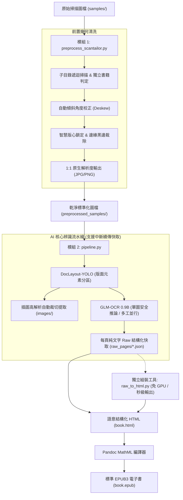

# ScanORC: 掃描書本轉語意結構化 HTML / EPUB 全流程數位化系統

[](https://www.python.org/)
[](https://pytorch.org/)
[](LICENSE)
[](https://developer.nvidia.com/cuda-zone)

**ScanORC** 是一套專為紙本書籍掃描檔打造的現代化端到端數位化流水線。系統整合了出版級幾何預處理引擎與最新的輕量級視覺語言模型（VLM），將傾斜、留白不均、帶有陰影的掃描圖檔，自動轉換為包含**原生高解析插圖**、**LaTeX/MathML 數學公式**與**結構化 Markdown 表格**的標準 HTML5 與 EPUB3 電子書。

---

## 🌟 核心特色

1. **出版級幾何轉正與去邊 (`preprocess_scantailor.py`)**：
   - **多階層子目錄遞迴**：自動遞迴掃描輸入目錄結構，並以完全相同的目錄樹鏡像輸出。
   - **獨立書籍版面判定**：每個子目錄視為一本獨立書籍，自動重新計算版心與轉正角度，絕不跨目錄沿用或殘留規格。
   - **1:1 原生尺寸無損輸出**：預設不進行任何圖形重新取樣或縮放，完整保留原始掃描之最高清晰度；支援自訂 `--dpi`。
   - **獨立幾何前置開關**：將自動旋轉校正、版心鎖定、清除黑邊、清除中縫陰影拆分為獨立選項，可單獨控制開啟或關閉；**預設僅啟用自動旋轉校正**（保持整頁原寸不裁切版心），若四項全關則直接無損秒級導出。

2. **精準版面分析與內容分離 (`DocLayout-YOLO`)**：
   - 採用以 YOLOv10 為基礎之出版版面偵測模型（39MB 超輕量）。
   - 智慧區分正文段落、標題、頁眉頁腳、表格、行內/行間數學公式、插圖與圖說文字。
   - **直排書籍相鄰正文欄位智慧合併 (BBox Column Merging)**：針對直排書籍中被 YOLO 割裂或因置信度偏低而漏檢中間數列正文的缺陷，系統自動檢測 $Y$ 軸高度重疊且 $X$ 軸相鄰的正文欄位，在無阻礙標題/插圖時進行智慧大框合併，既能 100% 補全漏檢正文，又能使長寬比恢復正常。
   - **直排左側收尾行智慧外擴偵測 (Vertical Trailing Column Absorption)**：針對直排書籍（由右向左讀）在章節或段落末尾的收尾行往往僅有數個字（例如「超級強勢股。」），因高度過短且左側/下方為大面積空白導致 YOLO 錨點置信度偏低而漏檢漏框的缺陷，系統主動探測正文區塊左側相鄰區域（1~2 行距內）的文字筆畫特徵，自動向左平滑外擴吸收並給予充足安全邊距，徹底根絕直排收尾短行被切邊漏字的現象。
   - **直排獨立章節標題保護與語意校正**：保護單列、頂部起排且與正文具備大留白間距（$\ge 120$px）的獨立章節標題，防止被相鄰欄位合併邏輯併入內文段落，並自動校正為 `title`（`<h2>`）語意標籤。
   - **裝飾切邊線條精確過濾**：針對直排書頁最右側之狹長裝飾斜紋花樣（寬度 $< 45$px）精準維持為 `abandon`，防止誤校正為文字區塊。
   - **包含候選框外擴邊界吸收 (BBox Expansion Absorption)**：在同類別候選框重疊包含去重時，由較大框主動吸收較小框向外擴展之邊界（`max(b1, b2)`），徹底防止直排首行/尾行右緣文字（如「很遺憾的」）被切邊腰斬與錯字。
   - **動態兩階段 Confidence 重試**：當第一階段（預設 `conf=0.10`）未偵測到有效內文區塊時，自動啟動第二階段寬鬆重試（`conf=0.05`），搭配邊界校正與跨類別 NMS 去重，徹底解決章節收尾半頁直排頁面漏檢問題。
   - **相互包含重疊區塊智慧去重**：修復相同或相近重複候選框互相排斥的問題，優先保留高置信度主要區塊。
   - 自動將非文字內容（插圖）、封面與全頁原圖統一裁切儲存為最佳化 `.jpg` 圖檔（預設 `quality=50`，並自動檢測是否為灰階以轉為單通道灰階儲存，大幅節省 75%~85% 空間並消除彩噪）並關聯至文章與 EPUB 中。

3. **強大視覺語言 OCR (`GLM-OCR 0.9B`)**：
   - 智譜開源 0.9B 多模態端到端模型，具備深厚的繁簡中文、排版與公式理解力。
   - **單圖獨立安全推論模式 (Single-crop Forward Pass)**：徹底消除多圖 Batch Padding 造成的跨區塊注意力 mask 污染、`\x00` 空字符死循環與記憶體碎片，隨解碼結束立即釋放顯存，推論速度更穩定。
   - **極端長寬比緩衝補白 (Aspect Ratio Cushion)**：針對長寬比超過 1:4 的直排狹長文字條，自動於水平兩側補白至安全比例，杜絕 CogViT 視覺編碼器因水平 Patch 數過少引起的注意力坍塌。
   - **空 Markdown 程式碼區塊標記徹底過濾**：自動識別並清除 GLM-OCR 在面對純裝飾或無文字裁切圖時產生的空 Markdown 代碼塊（```` ```markdown\n\n``` ````），杜絕無效程式碼標記殘留污染電子書標題或內文。
   - **LaTeX 語法與帶圈註腳符號標準化**：將 `\textcircled{n}`、`$①$`、上標註腳等符號自動正規化為標準 Unicode 帶圈字元（①、②...）或 HTML 上標，去除行內公式頭尾多餘空白，確保 Pandoc MathML 與 KaTeX 解析 100% 正確無殘留原始碼；全面支援已是 Unicode 帶圈字元（如 `\textcircled{③}`）與阿拉伯數字的安全容錯解析，杜絕 Python `isdigit()` 對 Unicode 數字判定導致 `int()` 拋出 `ValueError` 的崩潰問題。
   - **保底整頁 OCR 機制 (Full-page Fallback OCR)**：若版面分析未能切割出有效區塊，只要檢測頁面具備實質文字筆畫特徵，自動啟動 GLM-OCR 整頁端到端全幅面辨識，徹底避免文字頁誤退化為插圖。
   - **控制字符與空白區塊嚴格過濾**：自動清除 `\x00` 及非打印控制字符，杜絕空白行與無效標籤殘留。
   - 自動識別繁體中文、複雜排版表格並還原為標準 Markdown Table。
   - 數學公式自動識別並輸出為標準 LaTeX 語法（`$...$` 與 `$$...$$`）。

4. **標準 MathML EPUB 產出 (`Pandoc`)**：
   - 一鍵打包標準 EPUB3 電子書與獨立響應式 HTML5。
   - **HTML 程式碼與 C++ 泛型角括號自動逸出保護**：內建非標準 HTML 標籤白名單過濾清洗機制，自動將技術與程式書籍正文中的 C++ 泛型模板（如 `<Q>`、`<T>`、`<vector>` 等）及角括號轉譯為 HTML 實體（`&lt;...&gt;`），徹底杜絕 Pandoc HTML 解析器因標籤誤判引發之 `TagClose "p"` (status 64) 編譯中斷。
   - **現代橫排 LTR 閱讀器標準化**：為徹底避免各家電子書閱讀器（如 Apple Books、Kobo、Kindle、Calibre）在渲染直排（`vertical-rl`）與 RTL 翻頁時發生的 CSS 重疊崩潰與翻頁反向缺陷，EPUB 產出統一為現代標準橫排（LTR）；而網頁版 HTML5 則繼續完整支援直排/橫排自由切換。
   - 透過 Pandoc 數學引擎（`-f html+tex_math_dollars --mathml`），將 LaTeX 公式直接轉譯為現代電子書閱讀器原生支援的 **MathML 向量數學公式**，支援任意縮放不失真。

5. **多進程並行加速與參數相容性**：
   - **推薦頁面級多進程加速 (`--workers`)**：跨頁面獨立 Worker 並行，充分壓榨多核心 CPU 與大容量顯卡（如 16GB RTX 5060 Ti / 4080）算力，效能線性提升 3~4 倍且完全無跨區塊 padding 污染。
   - **CLI 與 GUI 向後相容性 (`--batch-size`)**：完整保留 `--batch-size` 介面相容既有腳本與配置；內部推論已全面升級為單圖安全推論模式。

6. **微創頁面修復與秒級重新編譯 (`patch_pages.py`)**：
   - 產出 HTML/EPUB 後，若人工檢查發現特定幾頁辨識不良或過於複雜，可直接指定檔名或頁碼將該頁替換為原始高解析圖檔。
   - 完整保留原頁面 id 與目錄跳轉錨點，並自動調用 Pandoc 在 **1~2 秒內**重新編譯完成最新 EPUB，徹底免除重跑數十分鐘全書 OCR 的時間成本。

7. **秒級 HTML/圖片直轉 EPUB (`html_to_epub.py`)**：
   - 提供輕量獨立工具，無需 GPU 或大型 AI 模型，依賴 Pandoc 即可直接將 `book.html` 與其同層 `images/` 目錄在 **1~2 秒內**秒級打包編譯為標準 MathML EPUB3 電子書。
   - 自動抽取 `<title>` 書名、語系設定，自動校驗所有插圖引用之完整性防止破圖，並支援自動偵測封面圖檔與自訂樣式。

8. **全功能視覺化控制台 (`app_gui.py`)**：
   - 基於 PyQt6 / PySide6 雙引擎架構打造，具備自適應原生引導機制，全面相容 Linux Fcitx5 繁簡中文輸入法切換。
   - 內建跨平台字型備選鏈 (Font Fallback Chain)，完美支援 `Noto Color Emoji` 全彩圖示與繁體中文顯示，徹底杜絕方框缺字 (Tofu)。
   - 提供完整分步頁籤：「批次多書處理」置首於第一分頁，依序為「一鍵端到端總控 → 幾何轉正裁切 → 目錄抽取 → AI 辨識 → 章節歸檔 → 微創修復」，最右側追加「HTML 轉 EPUB」與「圖片壓縮與縮放」專屬頁籤。
   - 預設參數全面最佳化（品質 50、縮放 1.0、銳化 1x0.55+1.5+0.002、邊距 1mm、Worker 1、Batch 2、預設自動分章歸檔）。
   - 內建智慧檔案清單與標記機制，所有參數可視化即時調整，並同步預覽與複製對應之 CLI 終端指令。
   - 非同步進程通訊，即時串流終端日誌，底層 Python 腳本 100% 解耦保留，可隨時於終端機單獨使用。

9. **智慧目錄解析與章節自適應 (`extract_toc.py` & `raw_to_html.py`)**：
   - **複合頁碼語法結構化解析**：除傳統通頁純數字（`105`）外，原生支援電腦技術與教材常見之章節複合頁碼（例如 `1-1`、`2-15`、`12·3`、`A-3`），自動萃取章節序號與章內頁次，並支援章內單調性檢驗與同章結束頁/頁數精準推導。
   - **圖檔命名自適應探測**：自動探測正文圖檔命名模式（全書連續通頁 `sequential` 如 `Page-001.jpg` vs 章節複合 `chapter_page` 如 `P01-001.jpg` / `02-015.jpg`）。
   - **零猜測直連章節歸檔**：在複合命名模式下，自動直接依 `(章節號, 頁碼)` 將各章圖檔精準歸入實體章節目錄（支援現存目錄與動態建立），杜絕孤立檔未配對遺漏。
   - **出版級 EPUB/HTML 錨點對齊**：`raw_to_html.py` 與 `html_to_epub.py` 自動支援複合頁碼與章節直連映射，各章首頁錨點與大綱精確對齊，徹底杜絕跨章末尾數字碰撞問題。

---

## 🏗️ 系統運作流程 (Workflow)



---

## 📦 系統需求與環境安裝

### 1. 系統相依套件

* **作業系統**：Linux (Ubuntu 20.04+, Debian, Arch, Fedora)
* **硬體需求**：
  * **最低配置**：4GB VRAM NVIDIA GPU（如 RTX 3050 / GTX 1650），可使用 `--batch-size 2 --workers 1`。
  * **推薦配置**：16GB VRAM NVIDIA GPU（如 RTX 5060 Ti / 4080），可使用 `--batch-size 4 --workers 4` 獲得 3~4 倍並行加速。
* **外掛系統工具**：
  * **Pandoc**：用於編譯 MathML EPUB。
    ```bash
    sudo apt update && sudo apt install -y pandoc
    ```
  * **ScanTailor-CLI（免安裝，專案已內建）**：
    本專案已自帶免安裝的 Portable 版 `bin/scantailor-cli` 與專屬執行環境（x86_64 Linux），**無需額外安裝任何系統套件或 Flatpak**，Clone 後立即可直接執行！
    *(系統若已安裝原生 `scantailor-cli` 或 Flatpak 版亦可自動備援偵測)*

---

### 2. 建立 Python 虛擬環境

建議使用 Python 3.10 或 3.11：

```bash
# 複製專案
git clone https://github.com/sophAi/scanorc.git
cd scanorc

# 建立並啟用虛擬環境
python3 -m venv .venv
source .venv/bin/activate

# 安裝 PyTorch (CUDA 12.4 版本)
pip install torch torchvision --index-url https://download.pytorch.org/whl/cu124

# 安裝專案相依套件
pip install -r requirements.txt
```

---

### 3. 下載 AI 模型權重

本專案提供自動下載腳本，自動從 HuggingFace 取得 DocLayout-YOLO 與 GLM-OCR 模型權重：

```bash
# 預設下載至專案內 models/
python download_models.py

# 或自訂集中存放目錄 (跨專案共享 / 外接硬碟 / NAS)，亦可設定環境變數 SCANORC_MODELS_DIR
python download_models.py --models-dir /opt/ai_models
```
模型將自動下載至：
* `<models_dir>/doclayout_yolo/` (~39MB)
* `<models_dir>/glm-ocr/` (~2.5GB)

> [!TIP]
> **集中存放與環境變數支援**：若有多個專案共用模型權重或存放於不同磁碟，可設定環境變數 `export SCANORC_MODELS_DIR=/path/to/models`（或直接使用系統預設 `/opt/models`），所有 CLI 工具與 GUI 控制台將自動優先沿用，無需重複下載與複製。

---

### 4. (選用) 打包為 Debian 安裝檔 (`.deb`)

本專案支援一鍵打包為標準的 Debian/Ubuntu 安裝包（採用**輕量微核心架構**，排除 2.6GB 大模型檔，預設集中指向 `/opt/models`，安裝包僅約 **6.7 MB**）：

```bash
# 一鍵建置 .deb 安裝包 (產出於 deb_dist/scanorc_1.0.0-1~mint22.3_amd64.deb)
./packaging/build_deb.sh

# 安裝至系統
sudo apt install ./deb_dist/scanorc_*.deb
```

安裝後系統將註冊以下全域指令與桌面圖示：
* `scanorc-gui`：啟動 ScanORC 桌面圖形控制台（應用程式選單亦有「ScanORC」捷徑圖示）。
* `scanorc`：一鍵執行端到端書籍數位化處理 (`process_book.py`)。
* `scanorc-raw2html`：由 `raw_pages/` 與 `toc.json` 免 GPU 極速秒級組裝 HTML / EPUB (`raw_to_html.py`)。
* `scanorc-pipeline`：AI 版面分析、OCR 辨識與斷點續傳快取流水線 (`pipeline.py`)。
* `scanorc-batch`：批次多書數位化調度器 (`batch_process.py`)。
* `scanorc-toc`：目錄頁結構化抽取工具 (`extract_toc.py`)。
* `scanorc-html2epub`：HTML 與 images 目錄秒轉 EPUB 工具 (`html_to_epub.py`)。
* `scanorc-recompress`：圖片批次重新壓縮與縮放工具 (`recompress_images.py`)。
* `scanorc-models`：一鍵下載/更新 AI 模型權重至 `/opt/models`。
* `scanorc-setup`：自動化建立/更新 ScanORC 專屬 Python 深度學習環境（`sudo scanorc-setup` 建立全機共用環境，或 `scanorc-setup --user` 建立個人環境）。

---

## 🚀 快速上手 (Quick Start)

### 方式 0：PySide6 桌面視覺化控制台（圖形介面，推薦初學者與視覺化操作）

若偏好圖形介面，可直接啟動內建的桌面控制台：

```bash
python app_gui.py
```

* **智慧檔案清單管理**：
  * **匯入與篩選**：支援一鍵匯入整目錄或個別圖檔，依自然檔名順序排列並支援關鍵字即時過濾。
  * **1080p 螢幕完美適配與欄位最佳化**：預設視窗尺寸 (1060x820) 與分割器比例精心調校，左側檔案清單 5 大欄位（`檔名`、`大小`、`📑 TOC`、`🚫 略過OCR`、`🩹 Patch`）全數完整展現無遮擋、無水平捲軸；檔名欄支援動態彈性拉伸，其餘標記欄固定最適像素寬度。
  * **右鍵捷徑選單**：支援 `🗑️ 從清單移除選取的檔案 (Delete / Backspace)`、`📑 標記為目錄頁 (TOC)`、`🚫 標記為略過 OCR`、`🩹 標記為 Patch 修復頁` 與 `📂 開啟所在資料夾`。
  * **雙向選擇與參數傳遞**：在左側表格選取單張或多張圖檔時，自動將選取路徑即時填入**步驟 1 (`--input`)**；勾選「略過 OCR」時同步傳入**步驟 1 (`--skip-orc`)**、**總控**與**步驟 3**；歸檔目錄則同步至**步驟 4 (`--organize-pages` 與 `--input`)**，亦可隨時點擊各步驟旁的「🔄 同步」按鈕手動同步。
* **分頁工作區與響應式排版**：
  * **🚀 一鍵端到端總控**：自動執行轉正 $\rightarrow$ 目錄抽取 $\rightarrow$ AI 辨識 $\rightarrow$ 章節歸檔全流程；內建「模型權重目錄 (`--models-dir`)」瀏覽與選取列；功能開關採雙排網格排列，兼顧緊湊與清晰。
  * **📐 步驟 1**：幾何轉正與裁切設定（支援多檔/多目錄輸入與 `--skip-orc` 略過處理設定）。
  * **📑 步驟 2**：目錄抽取（支援自訂模型目錄 `--models-dir`，內建 JSON 樹狀檢視與即時編輯儲存）。
  * **🤖 步驟 3**：AI 版面與 EPUB 生成（支援自訂模型目錄 `--models-dir`，快捷工具採 2x2 緊湊網格，支援即時開啟成果 HTML/EPUB 或直接重編）。
  * **📁 步驟 4**：章節目錄歸檔（支援圖檔移動或複製）。
  * **🩹 步驟 5**：頁面微創替換（支援 `--list` 狀態檢視與一鍵 `--revert` 還原）。
  * **📚 批次多書處理**：支援母目錄自動掃描 (`--input-dir`) 或自選多目錄 (`--dirs`)，全書預設參數包含模型權重目錄 (`--models-dir`)，提供斷點續傳 (`--skip-existing`)、TOC 自動優先沿用、Dry-run 排程模擬預覽與批次執行報告 (`batch_report.json`) 一鍵檢視。
* **各分頁 JSON 偏好設定載入與範本匯出（雙向繫結）**：
  * **主選單列快捷鍵**：上方提供 `檔案(&F)` 選單，支援 `Ctrl+O` 載入設定 (`-p`) 與 `Ctrl+S` 匯出範本 (`-t`)，完全不佔用任何水平版面寬度。
  * **分頁面板緊湊動作條**：每個 Tab 頂部皆內建 `[ 📂 載入設定 (-p) ] [ 💾 匯出設定 (-t) ]` 快捷按鈕，直觀標示對應之預設檔案（如 `book_config.json`, `batch_config.json`, `step1_config.json`, `step3_config.json` 等）。
  * **數值回填與指令同步**：支援解析包含 `//` 或 `/* */` 註解的 JSON，載入後自動將數值批次回填至該分頁的所有 UI 控制項，並同步刷新即時 CLI 指令預覽。
  * **完整參數反射匯出**：可隨時將當前 UI 調整的完整設定狀態另存為標準 JSON，可直接無縫供 CLI 腳本或 `batch_process.py` 批次處理讀取。
* **即時 CLI 指令預覽**：調整任何參數時，介面即時產生對應之終端機指令並支援一鍵複製到剪貼簿。
* **非同步日誌與進程控制**：即時串流顯示子進程日誌（自動去除終端色彩跳脫碼），支援進度條提示與安全強制中斷。
* **終端機視窗動態縮放與主題配色**：
  * **字級加大與即時縮放**：預設放大至 14px 舒適字級；支援底部快速按鈕 `A-` / `A+`、字級下拉選單（11px ~ 24px），以及直接在終端機視窗中按住 `Ctrl + 滑鼠滾輪` 進行無級縮放。
  * **5 組經典色彩主題**：內建「🌌 現代深灰 (Tokyo Night)」、「📟 經典駭客綠 (Matrix Green)」、「🌊 經典深藍 (Solarized Dark)」、「📻 復古琥珀橘 (Amber CRT)」與「📜 柔和白底 (Paper Light)」，支援一鍵即時換色。
  * **語意與狀態即時高亮**：採用高效 `QSyntaxHighlighter`，即時為任務進度 `[*]`、成功完成 `[+]`、錯誤例外 `[-] / Error`、慶祝完成 `[🎉]` 與分隔線自動套用對應的主題強調色彩。
* **環境相容性自動引導**：針對 Conda 舊版動態庫與 Linux Mint 22 等環境，內建自適應 bootstrap，自動配置 `QT_PLUGIN_PATH` 與 `LD_PRELOAD`，開箱即用徹底杜絕 Qt 插件衝突與段錯誤（Segmentation fault）。

---

### 方式 A：終端機一鍵端到端自動化處理（命令列推薦）

從只有原始圖檔（`Cover-xx.jpg` 與 `Page-xxx.jpg`）的目錄開始，一鍵完成：**轉正去邊裁切 $\rightarrow$ 目錄抽取 $\rightarrow$ HTML/EPUB 生成 $\rightarrow$ 章節目錄歸檔**：

```bash
# 一鍵全流程執行 (自動完成全套處理，生成 HTML 與 EPUB，並將圖檔分章歸檔)
python process_book.py --input samples --output output --workers 4

# 若有部分純圖片頁或難以辨識的頁面，可指定跳過 OCR 直接嵌入原圖（支援萬用字元如 'Cover-*.jpg' 'Content-*.jpg' 或單頁檔名）：
python process_book.py --input samples --output output --skip-ocr "Cover-*.jpg" "Content-*.jpg" Page-050.jpg
```

---

### 方式 B：分步獨立執行（進階客製）

#### 步驟 1：執行前置轉正與留白裁切
```bash
# 預設執行：各目錄獨立判定，1:1 原生尺寸輸出
python preprocess_scantailor.py --input samples --output preprocessed_samples
```

#### 步驟 2：抽取目錄索引
```bash
# 自動搜尋 Content-xx.jpg/content-xx.jpg 檔案群，或明確指定 -i 覆蓋
python extract_toc.py -o toc.json
```

#### 步驟 3：執行 AI 版面分析、OCR 與 EPUB 生成
```bash
# 多進程並行極速轉換 (預設以 Cover-01.jpg 作為封面，所在目錄名作為 title)
python pipeline.py --samples preprocessed_samples --output output --toc toc.json --batch-size 4 --workers 4 --epub
```

產出結果位於 `output/`：
* `output/book.html`：結構化 HTML5（內嵌 KaTeX 數學渲染、完整目錄導覽索引、頂部優雅封面展示與響應式排版）。
* `output/book.epub`：標準電子書（含正式封面、章節目錄、內嵌圖片與原生向量 MathML 公式）。
* `output/images/`：從版面中自動裁切出的高解析插圖、封面與全頁原圖。

---

### 方式 C：人工校對與特定異常頁微創替換 (`patch_pages.py`)

在轉換完成後，開啟 `output/book.html` 或 `output/book.epub` 進行人工快速翻閱。每個頁面頂部皆帶有 `File: Page-xxx.jpg` 標籤：
若發現特定幾頁排版崩壞或公式辨識錯誤，**無需重跑整本書（節省數十分鐘）**，只需執行 `patch_pages.py`：

```bash
# 1. 檢視全書所有頁面之當前呈現狀態 (OCR 辨識 vs 全頁原圖)
python patch_pages.py --list

# 2. 指定檔名或頁碼微創替換 (自動複製原圖至 output/images/ 並在 1~2 秒內重編 EPUB)
python patch_pages.py --pages Page-048.jpg Page-060.jpg
# 或直接傳入頁碼數字：
python patch_pages.py --pages 48 60
# 或傳入待修復頁面清單檔：
python patch_pages.py --pages bad_pages.txt

# 3. 若替換後欲還原至修改前的狀態：
python patch_pages.py --revert
```

---

### 方式 D：由 book.html 與 images 直接秒級生成 EPUB (`html_to_epub.py`)

若已產出 `book.html` 與 `images/` 目錄（或手動微調修改過 HTML），可直接執行 `html_to_epub.py`，**無需載入任何深度學習模型或 GPU**，在 1~2 秒內快速編譯出含有 MathML 公式渲染的高品質 EPUB3：

```bash
# 1. 預設轉換 (自動搜尋 output/book.html 或當前目錄之 book.html)：
python html_to_epub.py

# 2. 指定 HTML 檔案或輸出目錄：
python html_to_epub.py output/book.html
python html_to_epub.py output

# 3. 自訂 EPUB 檔名、書籍標題與封面圖檔：
python html_to_epub.py output/book.html -o output/final_book.epub --title "幾何學精要" --cover output/images/cover.jpg
```

---

### 方式 E：批次圖片重新壓縮與縮放 (`images_compressed.py` / `recompress_images.py`)

將來源目錄下的所有圖檔（**預設同時掃描 JPG 與 PNG，遞迴包含所有層級之子目錄**）以指定的壓縮率與縮放比例重新壓縮，**完整鏡像保持原目錄結構與檔案相對分布**，輸出至新目錄：

```bash
# 1. 基本壓縮：品質設為 75，維持所有子目錄結構鏡像輸出至 output_q75 (JPG 與 PNG 同步處理)：
python images_compressed.py samples -o output_q75 -q 75

# 2. 同時縮小尺寸 (例如尺寸縮小至 75% 且品質設為 70，自動套用至所有 JPG 與 PNG)：
python images_compressed.py samples -o output_compressed -q 70 -s 0.75

# 3. 多組品質與縮放比例批次生成 (自動在輸出目錄建立 q50_s100, q75_s75 等子目錄供對比評估)：
python images_compressed.py samples -o output_compare -q 50 75 85 -s 1.0 0.75

# 4. 指定最大長寬限制 (例如長邊不超過 1920 像素，等比縮小)：
python images_compressed.py samples -o output_hd -q 80 --max-dim 1920

# 5. 強制 PNG 保持無損全彩 (僅縮放尺寸與 zlib 最佳化壓縮，不執行量化降階)：
python images_compressed.py samples -o output_lossless -q 75 -s 0.8 --png-lossless
```

---

### 方式 F：多書籍目錄批次排程處理 (`batch_process.py`)

當有大量書籍目錄需要批次轉換時，使用 `batch_process.py` 進行循序佇列排程處理（避免多書同時佔用 GPU 顯存），支援各書專屬 `book_config.json` 與現成 `toc.json` 智慧沿用：

```bash
# 1. 自動掃描母目錄下的所有書籍子目錄並批次建置 (成果存放於 output_batch/書名/)：
python batch_process.py --input-dir /data/library --output-root /data/output_batch --workers 4

# 2. 中斷續傳 (若該書成果目錄已存在 book.epub 則自動略過)：
python batch_process.py --input-dir /data/library --skip-existing

# 3. 執行前先預覽排程與各目錄 TOC 狀態 (不實際執行運算)：
python batch_process.py --input-dir /data/library --dry-run
```

---

### 方式 G：統一 JSON 偏好設定與參數範本機制 (全工具程式支援)

ScanORC 旗下的**所有工具程式**（`process_book.py`, `batch_process.py`, `preprocess_scantailor.py`, `extract_toc.py`, `pipeline.py`, `patch_pages.py`, `html_to_epub.py`）皆全面支援統一的 JSON 參數驅動：

1. **匯出完整參數範本檔 (`-t` / `--template`)**：
   輸出包含該工具**所有可用參數與預設值**的標準 JSON 範本檔（包含 `margins`, `quality`, `workers`, `skip_ocr` 等全部參數）：
   ```bash
   # 匯出至檔案
   python process_book.py -t book_config.json
   python batch_process.py -t batch_config.json
   # 若未指定檔名，則直接印出至終端機 stdout
   python pipeline.py -t
   ```

2. **單一 JSON 檔案直接執行（最簡體驗）**：
   若工具程式僅傳入一個 `.json` 檔案作為唯一參數，預設自動讀取該 JSON 套用所有參數：
   ```bash
   python process_book.py book_config.json
   python batch_process.py batch_config.json
   ```

3. **套用設定檔並以命令列參數覆蓋 (`-p` / `--preference`)**：
   ```bash
   # 套用 JSON 設定，但臨時以 --workers 4 覆蓋該項參數
   python process_book.py -p book_config.json --workers 4
   # 亦支援別名 --config
   python process_book.py --config book_config.json
   ```

4. **GUI 控制台雙向匯入/匯出繫結**：
   在 `app_gui.py` 視覺化控制台中，各步驟面板皆可直接使用 `[ 📂 載入設定 (-p) ]` / `[ 💾 匯出設定 (-t) ]` 按鈕或主選單捷徑 `Ctrl+O` / `Ctrl+S` 與上述 JSON 範本進行雙向無縫同步與互轉。

---

## ⚙️ 詳細指令參數說明

### 1. `preprocess_scantailor.py`（前置處理引擎）

| 參數 | 簡寫 | 預設值 | 說明 |
| :--- | :---: | :---: | :--- |
| `--input` | `-i` | `samples` | 輸入來源路徑（支援單個/多個圖檔路徑、萬用字元或目錄，自動分組並遞迴掃描） |
| `--output` | `-o` | `preprocessed_samples` | 輸出目錄（自動鏡像建立相同的子目錄結構） |
| `--format` | `-f` | `jpg` | 最終圖檔格式，可選：`jpg`、`png`、`tif` |
| `--dpi` | - | `None` | 輸出解析度 DPI（**預設 None 不縮放，保持 1:1 原生像素**；指定時才執行重新取樣） |
| `--margins` | - | `1` | 版心四周均勻邊距大小 (單位: mm，預設 1，僅在啟用 `--content-box-lock` 時生效) |
| `--color-mode` | - | `color_grayscale` | 色彩模式：`color_grayscale` (保留插圖/照片階調)、`mixed`、`black_and_white` |
| `--despeckle` | - | `normal` | 去雜點強度：`normal`、`cautious`、`aggressive`、`off` |
| `--quality` | - | `50` | JPG 輸出壓縮品質 (1~100，預設 50，於畫面參數中即時顯示) |
| `--scale` | - | `1.0` | 輸出圖檔尺寸縮放比例（例如 0.8 或 1.0，預設: 1.0） |
| `--unsharp` | - | `1x0.55+1.5+0.002` | 影像銳化濾鏡參數（ImageMagick unsharp 語法，例如 1x0.55+1.5+0.002，設為 none 或 off 關閉） |
| `--auto-grayscale` | `--no-auto-grayscale` | `True` | 自動偵測圖檔是否為灰階色調，若無彩色資訊則改以灰階模式壓縮儲存以節省空間（內建封面保護與彩色細節防護，預設: True） |
| `--auto-rotate` | `--no-auto-rotate`, `--auto-deskew` | `True` | 自動偵測傾斜角度並旋轉校正（**預設啟用**，使用 `--no-auto-rotate` 關閉） |
| `--content-box-lock` | `--no-content-box-lock`, `--lock-content-box` | `False` | 鎖定版心內容邊界，依文字邊界自動裁切並套用邊距（**預設 False** 關閉，保持整頁原始尺寸） |
| `--remove-black-borders` | `--no-remove-black-borders`, `--clean-borders` | `False` | 清除掃描頁面四周的黑邊與雜點（**預設 False** 關閉） |
| `--remove-spine-shadow` | `--no-remove-spine-shadow`, `--clean-shadows` | `False` | 消除中縫漸層陰影與曲面平整化（**預設 False** 關閉） |
| `--batch-size` | - | `0` | 單一目錄分批大小 (預設 0 表示整章節一次性處理以維持版心尺寸統一) |
| `--skip-orc` | `--skip-ocr`, `--no-ocr` | `[]` | 略過 ScanTailor 幾何轉正與裁切處理的檔案清單（支援萬用字元如 `Cover-*.jpg`、`Content-*`、檔名、頁碼或 txt 清單，直接將原始圖檔導出至輸出目錄） |

---

### 2. `extract_toc.py`（目錄頁結構化抽取與自動分章工具）

| 參數 | 簡寫 | 預設值 | 說明 |
| :--- | :---: | :---: | :--- |
| `--input` | `-i` | `None` (自動搜尋) | 輸入目錄頁圖檔路徑或現有 `toc.json` 檔案（選填；**預設自動搜尋 `Content-xx.jpg` 或 `content-xx.jpg` 檔案群並依編號自然排序**，指定此參數則覆蓋預設搜尋） |
| `--output` | `-o` | `toc.json` | 輸出結構化 JSON 檔案路徑 |
| `--layout-direction` | - | `auto` | 目錄排版方向（`auto`: 依 Content-*.jpg 目錄圖檔自動判斷, `horizontal`: 橫排, `vertical`: 直排） |
| `--models-dir` | - | `None` | AI 模型權重母目錄（預設讀取 `<models-dir>/glm-ocr`；若未指定則依序檢查 `SCANORC_MODELS_DIR` 與專案內建 `models/`） |
| `--model-dir` | - | `models/glm-ocr` | GLM-OCR 模型權重目錄（若指定則具最高優先權覆蓋 `--models-dir`） |
| `--book-title` | - | `""` | 書名（選填，若未指定則自動由圖檔所在目錄推測並記錄於 JSON metadata） |
| `--organize-pages` | - | `None` | 自動建立對應目錄（如 `01-一切從此開始`），並將 `Page-xxx.jpg` 或 `P01-xxx.jpg` 檔案移入對應章節目錄（可指定目錄；未指定則預設整理輸入圖檔所在目錄） |
| `--copy` | - | `False` | 配合 `--organize-pages` 使用：改為複製圖檔而非移動圖檔 |
| `--auto-accept-guess` | - | `True` | 當候選目錄 (toc_guess) 品質符合門檻 (頁碼覆蓋率>=60%且順序正確) 時自動採納並寫入 toc.json |

> [!TIP]
> **強健的目錄解析與章節自適應機制**：
> - **複合頁碼語法抽取**：除傳統單一通頁頁碼外，原生支援複合章節頁碼（例如 `1-1`、`2-15`、`12·3`、`A-3`），並自動解析為結構化之章節序號與章內頁次。
> - **圖檔命名自適應探測**：自動探測正文圖檔命名模式（連續通頁 `sequential` 如 `Page-001.jpg` vs 章節複合 `chapter_page` 如 `P01-001.jpg` / `02-015.jpg`）。
> - **零猜測直連章節歸檔**：在複合命名模式下，自動直接依 `(章節號, 頁碼)` 將各章圖檔精準歸入實體章節目錄（支援現存目錄與動態建立），杜絕孤立檔遺漏。
> - **出版級 EPUB/HTML 錨點對齊**：`raw_to_html.py` 與 `html_to_epub.py` 自動支援複合頁碼與章節直連映射，各章首頁錨點與大綱精確對齊，徹底杜絕跨章末尾數字碰撞問題。
> - **多樣化導引符號穿透**：支援引導點線 (`...`)、破折號導引線（`——`、`—`、`―`、`─`、`~`）、直排跨行分離之純頁碼行配對、阿拉伯/中文數字前綴（如 `3.`、`4.`、`01.`）與直排底端頁碼補充偵測（Bottom-crop Fallback）。

---

### 3. `pipeline.py`（AI 核心辨識流水線）

| 參數 | 簡寫 | 預設值 | 說明 |
| :--- | :---: | :---: | :--- |
| `--samples` | `-i`, `--input` | `samples` | 待處理圖檔來源（支援單圖檔、多圖檔、目錄或萬用字元，可傳入多個路徑） |
| `--output` | `-o` | `output` | 成果儲存目錄（產出 HTML、EPUB 與裁切圖片） |
| `--title` | - | `數位化掃描書本` | 書名 / 文件標題（**預設以 `Cover-01.jpg` 所在的目錄名稱作為 title**；若無則自動套用 toc.json 或預設值） |
| `--toc` | - | `None` | 目錄結構 JSON 檔案路徑（自動生成目錄索引，並於對應頁面注入章節標題寫入 EPUB Outline 大綱） |
| `--layout-direction` | `--direction` | `auto` | 書籍排版方向（`auto`: 優先讀取 toc.json，次之自動抽樣檢測；支援 `horizontal` 橫排、`vertical` 直排，自動套用至 HTML 與 EPUB CSS） |
| `--cover` | `--cover-image` | `None` (自動搜尋) | 指定封面圖片路徑（**預設以 `Cover-01.jpg` 作為 EPUB 與 HTML 的封面**，亦相容 cover.*） |
| `--compress-images` | - | `False` | 是否在編譯 EPUB 前自動將 `output/images` 目錄中的圖檔額外重新壓縮與縮放（預設裁切與嵌入時已直接存為最佳化 `.jpg`） |
| `--image-quality` | - | `50` | `images/` 插圖與 EPUB 來源圖檔儲存與壓縮品質（1~100，預設: 50） |
| `--image-scale` | - | `1.0` | `images/` 圖檔尺寸縮放比例（例如 0.8 或 1.0，預設: 1.0） |
| `--image-max-dim` | - | `None` | `images/` 圖檔最大長寬像素限制（例如 1920，預設 None 不限制） |
| `--auto-grayscale` | `--no-auto-grayscale` | `True` | 儲存或重新壓縮 `images/` 圖檔時自動偵測是否為灰階色調並以單通道灰階模式壓縮儲存以節省空間（內建封面保護與彩色細節防護，預設: True） |
| `--recursive` | `-r` | `True` | 是否遞迴讀取子目錄所有圖檔（**預設啟用**，若使用 `--no-recursive` 則僅讀取頂層目錄） |
| `--cover-first` | - | `True` | 頁面編排順序：是否將封面/目錄頁（`Cover-*.jpg`）編排於內文頁（`Page-*.jpg`）之前（**預設啟用**；各群組內部均依自然數字順序排序） |
| `--epub` | - | `False` | 是否在生成 HTML 後自動調用 Pandoc 編譯 MathML EPUB |
| `--batch-size` | - | `2` | 單頁 OCR 批次參數（保留向後相容性；內部已全面採用單圖獨立安全推論；多工加速請使用 `--workers`） |
| `--workers` | - | `1` | 並行處理 Worker 進程數（建議：4GB 顯卡設 1；16GB 顯卡設 3~4） |
| `--skip-ocr` | `--skip-orc`, `--no-ocr` | `[]` | 不作 OCR 的檔案清單（支援萬用字元如 `Cover-*.jpg`、`Content-*`、檔名、頁碼或 txt 清單，直接以原始圖檔嵌入 HTML/EPUB） |
| `--models-dir` | - | `None` | AI 模型權重母目錄（自動解析子目錄內 YOLO 權重與 GLM 模型；亦可透過 `SCANORC_MODELS_DIR` 環境變數指定） |
| `--yolo-weights` | - | `None` | 明確指定 DocLayout-YOLO 權重檔案 (.pt) 路徑（優先級高於 `--models-dir`） |
| `--glm-model-dir` | - | `None` | 明確指定 GLM-OCR 模型目錄路徑（優先級高於 `--models-dir`） |
| `--raw-pages-dir` | - | `None` (預設 `<output>/raw_pages`) | OCR 各頁純文字 JSON 結構快取存放目錄 |
| `--force-ocr` | - | `False` | 強制忽略既有 `raw_pages/` 快取，一律重新調用 AI 模型推論 |

> [!TIP]
> **全自動斷點續傳快取與智慧失敗標記 (Breakpoint Resume & Failure Tracking)**：
> 1. **每頁獨立原子寫入**：每當單一頁面完成版面分析與 OCR 識別，立即以原子操作寫入 `<output>/raw_pages/<stem>.json`。
> 2. **失敗頁面獨立命名 (`Page-xxx_fail.json`)**：當單頁發生推論異常、或偵測到實質文字筆畫但未能抽取任何文字區塊而降級為原圖嵌入時，自動寫入 `<output>/raw_pages/<stem>_fail.json`，並內嵌原圖 figure 備援與錯誤原因，方便使用者透過 `ls *fail*` 迅速盤點問題頁面。
> 3. **意外中斷無痛恢復與自動重試**：重新執行時，`pipeline.py` 會自動統計快取命中率，對成功快取直接秒級跳過；對先前標記失敗的 `*_fail.json` 視為未成功快取並自動重新推論，成功後自動清理舊的 `_fail.json`。
> 4. **全書齊全 0 延遲秒級直出 (0 VRAM / 0s Latency)**：若全書所有頁面之 raw 檔均已齊全，將**完全略過 DocLayout-YOLO 與 GLM-OCR 模型載入**，零顯存佔用直接在 0.1 秒內秒級組裝 HTML 與 EPUB。
> 5. **直排版面高靈敏度與收尾短行防漏**：DocLayout-YOLO 預設門檻調降至 `conf=0.10`（具備 0.05 極寬鬆動態重試），搭配相鄰欄位合併與**左側收尾行智慧外擴偵測**，徹底解決直排漢字邊緣部首削切以及章節段落末尾 1~10 字短行漏檢漏框問題。
> 6. **自適應多階緩衝補白推論 (Adaptive Multi-tier Cushion Retry)**：針對極端長寬比直排長條，依序採用 `4.0x -> 2.0x -> 原圖直推` 智慧重試，徹底根絕視覺編碼器水平 patch 不足引發的 `\x00` 注意力坍塌與短標題過度補白問題。
> 7. **插圖實體存在性防護**：載入快取時會自動檢驗 `type == "figure"` 引用的插圖檔案是否實體存在。若圖片被誤刪，快取自動失效重跑 OCR 重新裁切。

---

### 4. `process_book.py`（端到端一鍵書籍數位化總控腳本）

| 參數 | 簡寫 | 預設值 | 說明 |
| :--- | :---: | :---: | :--- |
| `--input` | `-i` | `samples` | 輸入書籍原始圖檔目錄（包含 `Cover-xx.jpg` 與 `Page-xxx.jpg`） |
| `--output` | `-o` | `output` | 輸出成果目錄（產出 HTML、EPUB、images/ 與 preprocessed/） |
| `--title` | `-T` | `""` | 書名 / 文件標題（若未指定則自動從目錄名或 toc.json 讀取） |
| `--toc` | - | `None` | 指定現有目錄結構 JSON 檔案路徑（若未指定且目錄中存在 `toc.json`，將自動優先沿用） |
| `--force-toc` | - | `False` | 強制忽略既有 `toc.json`，一律重新以 AI 抽取目錄 |
| `--layout-direction` | `--direction` | `auto` | 書籍排版方向（`auto`: 優先讀取 toc.json，次之自動抽樣檢測；支援 `horizontal` 橫排、`vertical` 直排） |
| `--cover` | `--cover-image` | `None` | 指定 EPUB 封面圖檔路徑（未指定則自動在輸入或轉正目錄中偵測 Cover-*.jpg） |
| `--compress-images` | `--no-compress-images` | `True` | 是否在打包 EPUB 前將 `images/` 目錄圖檔重新壓縮與縮放（**預設啟用**，大幅瘦身 EPUB） |
| `--image-quality` | - | `50` | `images/` 插圖與 EPUB 來源圖檔儲存與壓縮品質（1~100，預設: 50） |
| `--image-scale` | - | `0.8` | `images/` 圖檔尺寸縮放比例（預設: 0.8） |
| `--image-max-dim` | - | `None` | images 圖檔最大長寬限制（例如 1920，預設 None 不限制） |
| `--dpi` | - | `None` | 輸出解析度 DPI（預設保持 1:1 原生尺寸無損輸出） |
| `--margins` | - | `1` | 版心四周均勻留白邊距 (mm，預設: 1) |
| `--quality` | - | `50` | 轉正裁切若輸出為 JPG 時的壓縮品質 (1~100，預設: 50) |
| `--scale` | - | `1.0` | 轉正裁切圖檔尺寸縮放比例 (預設: 1.0) |
| `--unsharp` | - | `1x0.55+1.5+0.002` | 轉正裁切銳化濾鏡參數 (ImageMagick unsharp 語法，預設: 1x0.55+1.5+0.002) |
| `--auto-rotate` | `--no-auto-rotate` | `True` | 步驟 1 轉正：自動旋轉校正（**預設: True**） |
| `--content-box-lock` | `--no-content-box-lock` | `False` | 步驟 1 轉正：版心鎖定裁切（**預設: False**，保持整頁原始尺寸） |
| `--remove-black-borders` | `--no-remove-black-borders` | `False` | 步驟 1 轉正：清除邊緣黑邊（**預設: False**） |
| `--remove-spine-shadow` | `--no-remove-spine-shadow` | `False` | 步驟 1 轉正：清除中縫陰影（**預設: False**） |
| `--auto-grayscale` | `--no-auto-grayscale` | `True` | 自動偵測圖檔是否為灰階色調並以灰階模式壓縮儲存以進一步節省空間（內建封面保護與彩色細節防護，預設: True） |
| `--color-mode` | - | `color_grayscale` | 轉正色彩模式：`color_grayscale`、`mixed`、`black_and_white` |
| `--workers` | - | `1` | 多進程並行 Worker 數（預設 1；16GB 顯卡可設 3~4） |
| `--batch-size` | - | `2` | 單頁 OCR 批次參數（保留向後相容性；內部採單圖安全推論；加速請使用 `--workers`） |
| `--skip-ocr` | `--skip-orc`, `--no-ocr` | `[]` | 不作 OCR / 轉正處理的檔案清單（支援萬用字元如 `Cover-*.jpg`、`Content-*`、檔名、頁碼或 txt 清單；自動於步驟 1 傳入 `--skip-orc`，於步驟 3 傳入 `--skip-ocr`） |
| `--epub` | `--no-epub` | `True` | 是否自動編譯 MathML EPUB3（預設: True） |
| `--organize-pages` | `--no-organize-pages` | `True` | 是否自動執行章節目錄結構建立與 Page-xxx.jpg 歸檔（**預設啟用**） |
| `--copy` | - | `False` | 章節歸檔時改為複製而非移動圖檔（預設: 移動圖檔） |
| `--organize-target` | - | `preprocessed` | 建立章節目錄並歸檔之目標：`preprocessed` 或 `input` |
| `--models-dir` | - | `None` | AI 模型權重母目錄（若指定則自動透傳至 `extract_toc.py` 與 `pipeline.py`；亦可透過 `SCANORC_MODELS_DIR` 設定） |
| `--preference` | `-p`, `--config`, `-c` | `None` | 載入 JSON 偏好設定檔並套用所有參數（命令列傳入者具最高優先覆蓋權） |
| `--template` | `-t`, `--dump-config` | `None` | 匯出包含此腳本全部參數預設值之標準 JSON 範本檔（可指定檔名，留空印至終端機） |

---

### 5. `patch_pages.py`（頁面微創替換與快速重編工具）

| 參數 | 簡寫 | 預設值 | 說明 |
| :--- | :---: | :---: | :--- |
| `--pages` | `-P` | `[]` | 欲替換為原圖的檔案名稱、頁碼或清單文字檔 (如: `Page-048.jpg`、`48` 或 `bad.txt`) |
| `--html` | - | `output/book.html` | 待修改的 HTML 檔案路徑 |
| `--source` | `-s` | `output/preprocessed` 等 | 原始圖檔搜尋來源目錄 (可指定多個目錄，自動遞迴搜尋) |
| `--epub` | `--no-epub` | `True` | 替換完成後是否自動呼叫 Pandoc 重新編譯 MathML EPUB |
| `--backup` | `--no-backup` | `True` | 是否在修改前自動生成 `.bak` 備份檔案 |
| `--revert` | - | `False` | 一鍵還原至先前的備份檔案 (`book.html.bak`) 並重編 EPUB |
| `--list` | `-l` | `False` | 檢視 HTML 檔案中所有頁面目前之狀態清單與原圖/OCR 統計 |
| `--preference` | `-p`, `--config`, `-c` | `None` | 載入 JSON 偏好設定檔並套用所有參數 |
| `--template` | `-t`, `--dump-config` | `None` | 匯出包含此腳本全部參數預設值之標準 JSON 範本檔 |

---

### 6. `html_to_epub.py`（HTML 與圖片秒級轉 EPUB 工具）

| 參數 | 簡寫 | 預設值 | 說明 |
| :--- | :---: | :---: | :--- |
| `input` | `--html`, `-i` | `output/book.html` | 輸入 HTML 檔案路徑或包含 book.html 的目錄 |
| `--output` | `-o` | `<html_dir>/<stem>.epub` | 輸出 EPUB 檔案路徑 |
| `--images` | `--images-dir` | `images/` | 圖片資源目錄（預設自動搜尋 HTML 旁的 images/ 資料夾） |
| `--toc` | - | `None` | 目錄結構 JSON 檔案路徑（未指定則自動在同目錄搜尋 `toc.json`，自動注入 `<h1>` 章節標題至 EPUB Outline 大綱） |
| `--layout-direction` | `--direction` | `auto` | 版面排版方向（`auto`: 預設讀取 `toc.json` 的直橫排設定；支援 `horizontal` 橫排、`vertical` 直排，亦可手動指定套用至 EPUB 與 HTML CSS） |
| `--title` | `-T` | 自動提取 | 書籍標題（預設自動自 HTML `<title>` 標籤中抽取） |
| `--author` | `-a` | `None` | 書籍作者名稱（選填） |
| `--lang` | `-l` | 自動提取 | 語系代碼（預設自動自 HTML `<html lang>` 讀取，若無則為 zh-TW） |
| `--cover` | `-C` | 自動偵測 | 封面圖片路徑（選填，未指定則自動偵測 Cover-*.jpg 或 cover.* 圖檔） |
| `--compress-images` | - | `False` | 編譯 EPUB 前是否自動重新壓縮 images/ 中的 JPG 與 PNG 圖檔 |
| `--image-quality` | - | `75` | images 圖檔壓縮品質（1~100，預設: 75） |
| `--image-scale` | - | `1.0` | images 圖檔尺寸縮放比例（例如 0.8 或 1.0） |
| `--image-max-dim` | - | `None` | images 圖檔最大長寬限制（例如 1920） |
| `--css` | - | `None` | 自訂 EPUB 樣式表 CSS 檔案路徑 |
| `--toc-depth` | - | `3` | EPUB 目錄深度層級 |
| `--no-toc` | - | `False` | 不生成 EPUB 目錄導覽 |
| `--no-mathml` | - | `False` | 停用 LaTeX 數學公式轉譯為 MathML 向量公式 |
| `--chapter-level` | - | `1` | EPUB 章節切分標題層級（預設依 h1 章節切分獨立 XHTML） |
| `--preference` | `-p`, `--config`, `-c` | `None` | 載入 JSON 偏好設定檔並套用所有參數 |
| `--template` | `-t`, `--dump-config` | `None` | 匯出包含此腳本全部參數預設值之標準 JSON 範本檔 |

---

### 7. `raw_to_html.py`（OCR Raw 檔純文字直接組裝 HTML / EPUB 工具）

| 參數 | 簡寫 | 預設值 | 說明 |
| :--- | :---: | :---: | :--- |
| `raw_dir` | `--input`, `-i`, `--raw-dir` | `output/raw_pages` | 各頁結構化 JSON 存放目錄（亦支援傳入 output 目錄自動解析） |
| `--output` | `-o` | `<raw_dir>/../book.html` | 輸出 HTML 檔案路徑 |
| `--toc` | - | `None` | 目錄結構 JSON 檔案路徑（未指定則自動在同層或上層目錄搜尋 `toc.json`） |
| `--title` | `-T` | 自動提取 | 書名 / 文件標題（未指定時優先自 toc.json 讀取） |
| `--cover` | `--cover-image` | `None` (自動搜尋) | 封面圖檔路徑（未指定則自動尋找 Cover-01.jpg 並複製確保不破圖） |
| `--layout-direction` | `--direction` | `auto` | 排版方向（`auto`: 優先繼承 toc.json；支援 `horizontal` 橫排、`vertical` 直排） |
| `--vertical` | - | - | 快捷選項：強制設定為直排模式 (豎排 / vertical-rl / RTL 翻頁) |
| `--horizontal` | - | - | 快捷選項：強制設定為橫排模式 (horizontal / LTR 翻頁) |
| `--cover-first` | `--no-cover-first` | `True` | 頁面編排順序：是否將 Cover-*.json 編排於 Page-*.json 之前 |
| `--epub` | - | `False` | 生成 HTML 後是否同步調用 Pandoc 編譯為標準 MathML EPUB3 電子書 |
| `--preference` | `-p`, `--config` | `None` | 載入 JSON 偏好設定檔並套用所有參數 |
| `--template` | `-t`, `--dump-config` | `None` | 匯出包含此腳本全部參數預設值之標準 JSON 範本檔 |

> [!TIP]
> **極速輕量與純文字版面調整**：
> `raw_to_html.py` 為純 Python 標準庫實作（免載入 PyTorch、YOLO 或 GLM，佔用 0 VRAM），執行時間僅需 **0.05 秒**。當使用者需要微調版面方向、替換封面、修改章節錨點或手動修正 `raw_pages/*.json` 中的文字/圖表設定時，可直接透過本工具在 0.1 秒內秒級重新生成 HTML 與 EPUB，完全免去耗時的 AI 模型推論。

---

### 8. `batch_process.py`（多書籍目錄批次數位化調度器）

| 參數 | 簡寫 | 預設值 | 說明 |
| :--- | :---: | :---: | :--- |
| `--input-dir` | `-i` | `None` | 母目錄路徑：自動掃描其第一層子目錄作為各書籍來源（例如: `library/`） |
| `--dirs` | `-d` | `[]` | 明確指定一個或多個書籍圖檔目錄（例如: `-d /path/book1 /path/book2`） |
| `--output-root` | `-o` | `output_batch` | 批次成果總輸出目錄，每本書獨立存於 `<output-root>/<書名>/` |
| `--pattern` | - | `*` | 子目錄過濾萬用字元（搭配 `--input-dir` 使用，例如: `Vol-*`） |
| `--config-name` | - | `book_config.json` | 各書籍目錄內專屬偏好設定檔檔名（預設自動搜尋 `book_config.json`、`preference.json` 等） |
| `--layout-direction` | `--direction` | `auto` | 書籍排版方向（`auto`: 優先讀取各書 `toc.json`，次之自動抽樣檢測；支援 `horizontal` 橫排、`vertical` 直排） |
| `--quality` | - | `50` | 轉正裁切若輸出為 JPG 時的壓縮品質 (預設: 50) |
| `--scale` | - | `1.0` | 轉正裁切圖檔尺寸縮放比例 (預設: 1.0) |
| `--unsharp` | - | `1x0.55+1.5+0.002` | 轉正裁切銳化濾鏡參數 (ImageMagick unsharp 語法，預設: 1x0.55+1.5+0.002) |
| `--auto-rotate` | `--no-auto-rotate` | `True` | 步驟 1 轉正：自動旋轉校正（**預設: True**） |
| `--content-box-lock` | `--no-content-box-lock` | `False` | 步驟 1 轉正：版心鎖定裁切（**預設: False**，保持整頁原始尺寸） |
| `--remove-black-borders` | `--no-remove-black-borders` | `False` | 步驟 1 轉正：清除邊緣黑邊（**預設: False**） |
| `--remove-spine-shadow` | `--no-remove-spine-shadow` | `False` | 步驟 1 轉正：清除中縫陰影（**預設: False**） |
| `--auto-grayscale` | `--no-auto-grayscale` | `True` | 自動偵測圖檔是否為灰階色調並以灰階模式壓縮儲存以進一步節省空間（內建封面保護與彩色細節防護，預設: True） |
| `--skip-existing` | - | `False` | 斷點續傳：若該書輸出目錄已存在 `book.epub`（或 `book.html`）則自動略過 |
| `--use-existing-toc` | `--no-use-existing-toc` | `True` | 若目錄中存在 `toc.json`，是否優先沿用並跳過 AI 抽取 |
| `--force-toc` | - | `False` | 強制忽略既有 `toc.json`，一律重新以 AI 抽取目錄 |
| `--continue-on-error` | `--no-continue-on-error` | `True` | 單本書籍處理失敗時記錄錯誤並繼續處理下一本 |
| `--stop-on-error` | - | `False` | 任一本書籍處理失敗時立即中止整個批次佇列 |
| `--dry-run` | - | `False` | 僅解析掃描各目錄設定與 TOC 狀態並輸出預覽清單，不實際執行運算 |
| `--report` | - | `<output-root>/batch_report.json` | 批次彙整報告輸出路徑（同時自動產出 Markdown 格式日誌） |
| `--models-dir` | - | `None` | AI 模型權重母目錄（若指定則透傳至各書籍之 `process_book.py`；亦可透過 `SCANORC_MODELS_DIR` 設定，支援各書目錄內 `book_config.json` 獨立覆蓋） |
| `--skip-ocr` | - | `['Cover-*.jpg', 'Content-*.jpg']` | 預設免 OCR / 轉正處理之頁面萬用字元清單（自動透傳至各書籍之 `process_book.py`，支援各書目錄 `book_config.json` 獨立覆蓋） |
| `--preference` | `-p`, `--config`, `-c` | `None` | 載入批次全域偏好設定檔 |
| `--template` | `-t`, `--dump-config` | `None` | 匯出批次調度器全參數預設值之標準 JSON 範本檔 |

---

### 9. `images_compressed.py` / `recompress_images.py`（JPG 與 PNG 批次重新壓縮與縮放工具）

| 參數 | 簡寫 | 預設值 | 說明 |
| :--- | :---: | :---: | :--- |
| `input` | `--input`, `-i` | 必填 | 輸入來源目錄路徑（**預設同時掃描 JPG 與 PNG，涵蓋所有層級之子目錄**） |
| `--output` | `-o` | 必填 | 輸出目標新目錄路徑（將完整鏡像重建子目錄結構） |
| `--quality` | `-q` | `[50]` | 壓縮品質（1~100；對 JPG 為編碼品質，對 PNG 為調色盤自適應量化品質；預設: 50） |
| `--scale` | `-s` | `['1.0']` | 尺寸縮放比例（如 `0.75` 或 `75%`；預設: 1.0） |
| `--unsharp` | - | `1x0.55+1.5+0.002` | 影像銳化參數（ImageMagick unsharp 語法，例如 1x0.55+1.5+0.002，設為 none 或 off 關閉） |
| `--auto-grayscale` | `--no-auto-grayscale` | `True` | 自動偵測圖檔是否為灰階色調，若無彩色資訊則改以灰階模式壓縮儲存以進一步節省空間（內建封面保護與彩色細節防護，預設: True） |
| `--max-dim` | `-m` | `None` | 限制圖片最大長寬（像素，如 1920，若超過則等比縮小） |
| `--workers` | `-w` | `CPU核心數` | 並行 Worker 數 |
| `--png-lossless` | - | `False` | 強制 PNG 保持無損全彩（不執行量化降階，僅套用 -s 縮放與 zlib 最佳化壓縮） |
| `--subsampling` | - | `keep` | [JPG專用] 色度抽樣模式：`keep` (保留)、`444` (最高清)、`420` (最高壓縮) |
| `--no-optimize` | - | `False` | 停用 Huffman / zlib 編碼最佳化 |
| `--progressive` | - | `False` | [JPG專用] 啟用漸進式 JPEG 編碼 |
| `--strip-metadata` | - | `False` | 移除 EXIF、DPI 與色彩設定檔（預設完整保留；若由 RGB 轉灰階自動安全排除 RGB ICC 設定檔） |
| `--dry-run` | - | `False` | 模擬執行模式（僅預覽檔案與目錄路徑，不實際寫入） |
| `--quiet` | - | `False` | 精簡輸出 |

> [!TIP]
> **智慧灰階壓縮最佳化 (Auto-Grayscale)**：全系統在壓縮儲存 JPG 時，預設自動分析圖檔色彩資訊。
> 1. **原生灰階色彩空間快速判定 (Fast-path)**：若原始圖檔色彩空間本身已是灰階模式（單通道 `L` / `1` / `LA`），以 Header-only 讀取直接確認，零解碼延遲保留灰階模式儲存，完全略過冗餘像素解碼與色差計算，判定速度提速數百倍。
> 2. **自適應灰階判斷**：若頁面原本以 24-bit 彩色格式儲存但實質上為黑白/灰階，自動改用單通道灰階（Grayscale JFIF）壓縮，可再額外縮減 5%~15% 檔案容量，徹底消除灰階閱讀器上的彩噪色斑。
> 3. **封面絕對保護與彩色細節防護**：內建**封面保護**（`Cover-*.jpg` 只要有任何非零色差一律維持全彩）與**高彩度細節防護**（精確識別細微彩色印章、標註、雙色印刷標題等，絕不誤轉）。

---

## 📊 硬體資源與顯存 (VRAM) 調優建議

GLM-OCR 0.9B 模型在 FP16 精度下單個實例基準佔用約 **2.1 GB VRAM**。

| 顯卡規格 | 建議設定 | 預期總 VRAM 佔用 | 吞吐速度 (400 頁書) |
| :--- | :--- | :---: | :---: |
| **4GB ~ 6GB** (RTX 3050/2060) | `--workers 1 --batch-size 2` | ~ 2.2 GB | ~ 40~50 分鐘 |
| **8GB** (RTX 3070/4060) | `--workers 2 --batch-size 2` | ~ 4.4 GB | ~ 22~28 分鐘 |
| **16GB** (RTX 5060 Ti / 4080) | `--workers 4 --batch-size 4` | ~ 9.0 ~ 10.5 GB | **~ 10~15 分鐘** (加速 3.5×) |

> [!TIP]
> 在 16GB 顯卡環境下，**增加 `--workers`（多進程並行處理多頁）的加速效果遠大於僅加大單頁 `--batch-size`**。因為多進程能同時並行 DocLayout-YOLO 檢測、GLM-OCR 批次推理與 CPU 圖片前處理，達到最大化 GPU 算力利用率。

---

## 💾 磁碟空間與快取重定向指引 (防止根目錄爆滿)

在多書籍批次處理或大型書籍全流程推論時，若系統根目錄（`/`）空間有限（例如系統碟僅剩餘數 GB），深度學習框架快取與崩潰傾印檔可能在執行過程中寫入家目錄（`/home`）導致空間用光：

1. **AI 快取與暫存目錄重定向至大容量硬碟（如 `/opt`）**：
   可將 Hugging Face 動態模組快取、PyTorch / Triton GPU 核心動態編譯與系統暫存導向空間充足的資料磁碟：
   ```bash
   # 1. 建立專用暫存與快取資料夾
   mkdir -p /opt/tmp /opt/cache/huggingface /opt/cache/torch /opt/cache/triton

   # 2. 設定環境變數 (可寫入 ~/.bashrc 或包入啟動腳本)
   export TMPDIR=/opt/tmp
   export HF_HOME=/opt/cache/huggingface
   export TORCH_HOME=/opt/cache/torch
   export TRITON_CACHE_DIR=/opt/cache/triton
   export SCANORC_MODELS_DIR=/opt/models
   ```

2. **管理 Systemd 核心傾印檔 (Coredump)**：
   若 Worker 行程在高負載下遭遇 CUDA 記憶體不足 (OOM)，Linux 系統預設會將數百 MB 至數 GB 的記憶體傾印寫入 `/var/lib/systemd/coredump/`，多次崩潰可能迅速耗盡磁碟：
   - **清理既有傾印檔以釋放空間**：
     ```bash
     sudo coredumpctl vacuum --size-set=100M
     # 或直接刪除：
     sudo rm -f /var/lib/systemd/coredump/*
     ```
   - **工作階段關閉 Coredump 寫入**：
     ```bash
     ulimit -c 0
     ```

---

## 📂 專案檔案結構

```text
scanorc/
├── .gitignore               # Git 忽略設定 (排除大型權重與快取)
├── LICENSE                  # MIT 授權條款
├── README.md                # 專案詳細說明文件
├── requirements.txt         # Python 套件清單
├── download_models.py       # 自動下載 HuggingFace 模型權重
├── app_gui.py               # [GUI 控制台] 視覺化 5 步驟 + 2 大總控操作介面 (PyQt6 / PySide6)
├── batch_process.py          # [批次總控] 多目錄/多書籍循序批次數位化調度器
├── config_utils.py           # [通用設定] 統一 JSON 參數範本反射與帶註解偏好設定核心模組
├── process_book.py          # [一鍵總控] 端到端全流程自動化腳本 (轉正->TOC->EPUB->分章)
├── patch_pages.py           # [微創修復] 異常頁面原圖替換與秒級重編工具
├── html_to_epub.py          # [獨立打包] 由 book.html 與 images 直接秒級生成 EPUB 工具
├── images_compressed.py     # [批次壓縮] 遞迴鏡像子目錄之 JPG 與 PNG 重新壓縮與縮放工具
├── recompress_images.py     # images_compressed.py 之主程式實作
├── recompress_jpg.py        # images_compressed.py 之捷徑符號連結
├── preprocess_scantailor.py # 出版級轉正、留白裁切與版心標準化前處理引擎
├── extract_toc.py           # 目錄頁結構化抽取工具 (方案 A: GLM-OCR -> JSON)
├── pipeline.py              # DocLayout-YOLO + GLM-OCR 端到端轉換流水線 (含斷點續傳快取)
├── raw_to_html.py           # [獨立組裝] OCR Raw 檔與 TOC 索引直接組裝 HTML/EPUB (免 GPU)
├── bin/                     # [自帶] 免安裝 ScanTailor-CLI 可攜版與執行庫 (方案 A - 作法 1)
│   ├── scantailor-cli       # 可攜式啟動腳本 (自動配置庫路徑)
│   ├── scantailor-cli-bin   # 原始 C++ 二進位檔
│   ├── lib/                 # 獨立 Qt4/JPEG 動態庫
│   └── plugins/             # Qt 圖像解碼外掛 (imageformats)
├── samples/                 # 預設範例掃描圖片目錄 (含測試樣張)
├── models/                  # [Ignored] AI 模型權重目錄 (執行 download_models.py 後生成)
│   ├── doclayout_yolo/      # DocLayout-YOLO 權重 (YOLOv10)
│   └── glm-ocr/             # GLM-OCR 0.9B 視覺語言模型
└── output/                  # [Ignored] 預設轉換產物輸出目錄
    ├── book.html            # 語意 HTML5
    ├── book.epub            # MathML EPUB3 電子書
    ├── images/              # 自動提取之插圖
    └── raw_pages/           # 每頁 OCR 純文字 JSON 結構快取檔 (*.json)
```

---

## 📄 授權條款 (License)

本專案基於 [MIT License](LICENSE) 條款開放開源。所依賴之模型依其原創作者條款使用：
* **DocLayout-YOLO**：基於 Apache-2.0 授權。
* **GLM-OCR**：基於 Apache-2.0 授權。
* **ScanTailor**：基於 GPLv3 授權。
