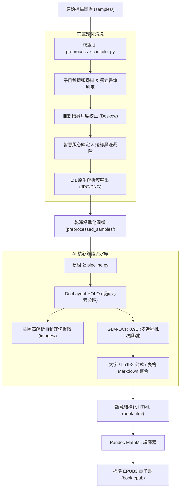

# ScanORC: 掃描書本轉語意結構化 HTML / EPUB 全流程數位化系統

[](https://www.python.org/)
[](https://pytorch.org/)
[](LICENSE)
[](https://developer.nvidia.com/cuda-zone)

**ScanORC** 是一套專為紙本書籍掃描檔打造的現代化端到端數位化流水線。系統整合了出版級幾何預處理引擎與最新的輕量級視覺語言模型（VLM），將傾斜、留白不均、帶有陰影的掃描圖檔，自動轉換為包含**原生高解析插圖**、**LaTeX/MathML 數學公式**與**結構化 Markdown 表格**的標準 HTML5 與 EPUB3 電子書。

---

## 🌟 核心特色

1. **出版級幾何轉正與去邊 (`preprocess_scantailor.py`)**：
   - **多階層子目錄遞迴**：自動遞迴掃描輸入目錄結構，並以完全相同的目錄樹鏡像輸出。
   - **獨立書籍版面判定**：每個子目錄視為一本獨立書籍，自動重新計算版心與轉正角度，絕不跨目錄沿用或殘留規格。
   - **1:1 原生尺寸無損輸出**：預設不進行任何圖形重新取樣或縮放，完整保留原始掃描之最高清晰度；支援自訂 `--dpi`。
   - **自動去除黑邊與雜訊**：自動清除掃描儀壓痕黑邊、書脊中縫漸層陰影與微小孤立黑點（Despeckle）。

2. **精準版面分析與內容分離 (`DocLayout-YOLO`)**：
   - 採用以 YOLOv10 為基礎之出版版面偵測模型（39MB 超輕量）。
   - 智慧區分正文段落、標題、頁眉頁腳、表格、行內/行間數學公式、插圖與圖說文字。
   - 自動將非文字內容（插圖）無損裁切儲存為獨立高解析圖檔並關聯至文章中。

3. **強大視覺語言 OCR (`GLM-OCR 0.9B`)**：
   - 智譜開源 0.9B 多模態端到端模型，具備深厚的繁簡中文、排版與公式理解力。
   - 自動識別繁體中文、複雜排版表格並還原為標準 Markdown Table。
   - 數學公式自動識別並輸出為標準 LaTeX 語法（`$...$` 與 `$$...$$`）。

4. **標準 MathML EPUB 產出 (`Pandoc`)**：
   - 一鍵打包標準 EPUB3 電子書與獨立響應式 HTML5。
   - 透過 Pandoc 數學引擎（`-f html+tex_math_dollars --mathml`），將 LaTeX 公式直接轉譯為現代電子書閱讀器原生支援的 **MathML 向量數學公式**，支援任意縮放不失真。

5. **多進程與批次並行加速**：
   - 支援單頁區塊批次推理 (`--batch-size`)。
   - 支援多進程獨立 Worker 並行 (`--workers`)，充分壓榨多核心 CPU 與大容量顯卡（如 16GB RTX 5060 Ti / 4080）算力。

6. **微創頁面修復與秒級重新編譯 (`patch_pages.py`)**：
   - 產出 HTML/EPUB 後，若人工檢查發現特定幾頁辨識不良或過於複雜，可直接指定檔名或頁碼將該頁替換為原始高解析圖檔。
   - 完整保留原頁面 id 與目錄跳轉錨點，並自動調用 Pandoc 在 **1~2 秒內**重新編譯完成最新 EPUB，徹底免除重跑數十分鐘全書 OCR 的時間成本。

7. **秒級 HTML/圖片直轉 EPUB (`html_to_epub.py`)**：
   - 提供輕量獨立工具，無需 GPU 或大型 AI 模型，依賴 Pandoc 即可直接將 `book.html` 與其同層 `images/` 目錄在 **1~2 秒內**秒級打包編譯為標準 MathML EPUB3 電子書。
   - 自動抽取 `<title>` 書名、語系設定，自動校驗所有插圖引用之完整性防止破圖，並支援自動偵測封面圖檔與自訂樣式。

8. **全功能視覺化控制台 (`app_gui.py`)**：
   - 基於 PyQt6 / PySide6 雙引擎架構打造，具備自適應原生引導機制，全面相容 Linux Fcitx5 繁簡中文輸入法切換。
   - 內建跨平台字型備選鏈 (Font Fallback Chain)，完美支援 `Noto Color Emoji` 全彩圖示與繁體中文顯示，徹底杜絕方框缺字 (Tofu)。
   - 提供完整分步頁籤（轉正 → 目錄抽取 → AI 辨識 → 章節歸檔 → 微創修復）與「一鍵端到端總控」，預設參數全面最佳化（邊距 1mm、品質 85、Worker 1、Batch 2、自動壓縮插圖、預設自動分章歸檔）。
   - 內建智慧檔案清單與標記機制，所有參數可視化即時調整，並同步預覽與複製對應之 CLI 終端指令。
   - 非同步進程通訊，即時串流終端日誌，底層 Python 腳本 100% 解耦保留，可隨時於終端機單獨使用。

---

## 🏗️ 系統運作流程 (Workflow)



---

## 📦 系統需求與環境安裝

### 1. 系統相依套件

* **作業系統**：Linux (Ubuntu 20.04+, Debian, Arch, Fedora)
* **硬體需求**：
  * **最低配置**：4GB VRAM NVIDIA GPU（如 RTX 3050 / GTX 1650），可使用 `--batch-size 2 --workers 1`。
  * **推薦配置**：16GB VRAM NVIDIA GPU（如 RTX 5060 Ti / 4080），可使用 `--batch-size 4 --workers 4` 獲得 3~4 倍並行加速。
* **外掛系統工具**：
  * **Pandoc**：用於編譯 MathML EPUB。
    ```bash
    sudo apt update && sudo apt install -y pandoc
    ```
  * **ScanTailor-CLI（免安裝，專案已內建）**：
    本專案已自帶免安裝的 Portable 版 `bin/scantailor-cli` 與專屬執行環境（x86_64 Linux），**無需額外安裝任何系統套件或 Flatpak**，Clone 後立即可直接執行！
    *(系統若已安裝原生 `scantailor-cli` 或 Flatpak 版亦可自動備援偵測)*

---

### 2. 建立 Python 虛擬環境

建議使用 Python 3.10 或 3.11：

```bash
# 複製專案
git clone https://github.com/sophAi/scanorc.git
cd scanorc

# 建立並啟用虛擬環境
python3 -m venv .venv
source .venv/bin/activate

# 安裝 PyTorch (CUDA 12.4 版本)
pip install torch torchvision --index-url https://download.pytorch.org/whl/cu124

# 安裝專案相依套件
pip install -r requirements.txt
```

---

### 3. 下載 AI 模型權重

本專案提供自動下載腳本，自動從 HuggingFace 取得 DocLayout-YOLO 與 GLM-OCR 模型權重：

```bash
python download_models.py
```
模型將自動下載至：
* `models/doclayout_yolo/` (~39MB)
* `models/glm-ocr/` (~2.5GB)

---

## 🚀 快速上手 (Quick Start)

### 方式 0：PySide6 桌面視覺化控制台（圖形介面，推薦初學者與視覺化操作）

若偏好圖形介面，可直接啟動內建的桌面控制台：

```bash
python app_gui.py
```

* **智慧檔案清單管理**：
  * **匯入與篩選**：支援一鍵匯入整目錄或個別圖檔，依自然檔名順序排列並支援關鍵字即時過濾。
  * **右鍵捷徑選單**：支援 `🗑️ 從清單移除選取的檔案 (Delete / Backspace)`、`📑 標記為目錄頁 (TOC)`、`🚫 標記為略過 OCR`、`🩹 標記為 Patch 修復頁` 與 `📂 開啟所在資料夾`。
  * **雙向選擇與參數傳遞**：在左側表格選取單張或多張圖檔時，自動將選取路徑即時填入**步驟 1 (`--input`)**；勾選「略過 OCR」時同步傳入**步驟 1 (`--skip-orc`)**、**總控**與**步驟 3**；歸檔目錄則同步至**步驟 4 (`--organize-pages` 與 `--input`)**，亦可隨時點擊各步驟旁的「🔄 同步」按鈕手動同步。
* **分頁工作區**：
  * **🚀 一鍵端到端總控**：自動執行轉正 $\rightarrow$ 目錄抽取 $\rightarrow$ AI 辨識 $\rightarrow$ 章節歸檔全流程。
  * **📐 步驟 1**：幾何轉正與裁切設定（支援多檔/多目錄輸入與 `--skip-orc` 略過處理設定）。
  * **📑 步驟 2**：目錄抽取（內建 JSON 樹狀檢視與即時編輯儲存）。
  * **🤖 步驟 3**：AI 版面與 EPUB 生成（支援即時開啟成果 HTML/EPUB）。
  * **📁 步驟 4**：章節目錄歸檔（支援圖檔移動或複製）。
  * **🩹 步驟 5**：頁面微創替換（支援 `--list` 狀態檢視與一鍵 `--revert` 還原）。
* **即時 CLI 指令預覽**：調整任何參數時，介面即時產生對應之終端機指令並支援一鍵複製到剪貼簿。
* **非同步日誌與進程控制**：即時串流顯示子進程日誌（自動去除終端色彩跳脫碼），支援進度條提示與安全強制中斷。
* **終端機視窗動態縮放與主題配色**：
  * **字級加大與即時縮放**：預設放大至 14px 舒適字級；支援底部快速按鈕 `A-` / `A+`、字級下拉選單（11px ~ 24px），以及直接在終端機視窗中按住 `Ctrl + 滑鼠滾輪` 進行無級縮放。
  * **5 組經典色彩主題**：內建「🌌 現代深灰 (Tokyo Night)」、「📟 經典駭客綠 (Matrix Green)」、「🌊 經典深藍 (Solarized Dark)」、「📻 復古琥珀橘 (Amber CRT)」與「📜 柔和白底 (Paper Light)」，支援一鍵即時換色。
  * **語意與狀態即時高亮**：採用高效 `QSyntaxHighlighter`，即時為任務進度 `[*]`、成功完成 `[+]`、錯誤例外 `[-] / Error`、慶祝完成 `[🎉]` 與分隔線自動套用對應的主題強調色彩。
* **環境相容性自動引導**：針對 Conda 舊版動態庫與 Linux Mint 22 等環境，內建自適應 bootstrap，自動配置 `QT_PLUGIN_PATH` 與 `LD_PRELOAD`，開箱即用徹底杜絕 Qt 插件衝突與段錯誤（Segmentation fault）。

---

### 方式 A：終端機一鍵端到端自動化處理（命令列推薦）

從只有原始圖檔（`Cover-xx.jpg` 與 `Page-xxx.jpg`）的目錄開始，一鍵完成：**轉正去邊裁切 $\rightarrow$ 目錄抽取 $\rightarrow$ HTML/EPUB 生成 $\rightarrow$ 章節目錄歸檔**：

```bash
# 一鍵全流程執行 (自動完成全套處理，生成 HTML 與 EPUB，並將圖檔分章歸檔)
python process_book.py --input samples --output output --workers 4

# 若有部分純圖片頁或難以辨識的頁面，可指定跳過 OCR 直接嵌入原圖：
python process_book.py --input samples --output output --skip-ocr Page-050.jpg Page-060.jpg
```

---

### 方式 B：分步獨立執行（進階客製）

#### 步驟 1：執行前置轉正與留白裁切
```bash
# 預設執行：各目錄獨立判定，1:1 原生尺寸輸出
python preprocess_scantailor.py --input samples --output preprocessed_samples
```

#### 步驟 2：抽取目錄索引
```bash
# 識別目錄頁並輸出標準 JSON 索引
python extract_toc.py -i preprocessed_samples/Cover-06.jpg -o toc.json
```

#### 步驟 3：執行 AI 版面分析、OCR 與 EPUB 生成
```bash
# 多進程並行極速轉換 (支援 --skip-ocr 指定免 OCR 頁面)
python pipeline.py --samples preprocessed_samples --output output --toc toc.json --batch-size 4 --workers 4 --epub
```

產出結果位於 `output/`：
* `output/book.html`：結構化 HTML5（內嵌 KaTeX 數學渲染、完整目錄導覽索引與響應式排版）。
* `output/book.epub`：標準電子書（含章節目錄、內嵌圖片與原生向量 MathML 公式）。
* `output/images/`：從版面中自動裁切出的高解析插圖與全頁原圖。

---

### 方式 C：人工校對與特定異常頁微創替換 (`patch_pages.py`)

在轉換完成後，開啟 `output/book.html` 或 `output/book.epub` 進行人工快速翻閱。每個頁面頂部皆帶有 `File: Page-xxx.jpg` 標籤：
若發現特定幾頁排版崩壞或公式辨識錯誤，**無需重跑整本書（節省數十分鐘）**，只需執行 `patch_pages.py`：

```bash
# 1. 檢視全書所有頁面之當前呈現狀態 (OCR 辨識 vs 全頁原圖)
python patch_pages.py --list

# 2. 指定檔名或頁碼微創替換 (自動複製原圖至 output/images/ 並在 1~2 秒內重編 EPUB)
python patch_pages.py --pages Page-048.jpg Page-060.jpg
# 或直接傳入頁碼數字：
python patch_pages.py --pages 48 60
# 或傳入待修復頁面清單檔：
python patch_pages.py --pages bad_pages.txt

# 3. 若替換後欲還原至修改前的狀態：
python patch_pages.py --revert
```

---

### 方式 D：由 book.html 與 images 直接秒級生成 EPUB (`html_to_epub.py`)

若已產出 `book.html` 與 `images/` 目錄（或手動微調修改過 HTML），可直接執行 `html_to_epub.py`，**無需載入任何深度學習模型或 GPU**，在 1~2 秒內快速編譯出含有 MathML 公式渲染的高品質 EPUB3：

```bash
# 1. 預設轉換 (自動搜尋 output/book.html 或當前目錄之 book.html)：
python html_to_epub.py

# 2. 指定 HTML 檔案或輸出目錄：
python html_to_epub.py output/book.html
python html_to_epub.py output

# 3. 自訂 EPUB 檔名、書籍標題與封面圖檔：
python html_to_epub.py output/book.html -o output/final_book.epub --title "幾何學精要" --cover output/images/cover.jpg
```

---

### 方式 E：批次圖片重新壓縮與縮放 (`images_compressed.py` / `recompress_images.py`)

將來源目錄下的所有圖檔（**預設同時掃描 JPG 與 PNG，遞迴包含所有層級之子目錄**）以指定的壓縮率與縮放比例重新壓縮，**完整鏡像保持原目錄結構與檔案相對分布**，輸出至新目錄：

```bash
# 1. 基本壓縮：品質設為 75，維持所有子目錄結構鏡像輸出至 output_q75 (JPG 與 PNG 同步處理)：
python images_compressed.py samples -o output_q75 -q 75

# 2. 同時縮小尺寸 (例如尺寸縮小至 75% 且品質設為 70，自動套用至所有 JPG 與 PNG)：
python images_compressed.py samples -o output_compressed -q 70 -s 0.75

# 3. 多組品質與縮放比例批次生成 (自動在輸出目錄建立 q50_s100, q75_s75 等子目錄供對比評估)：
python images_compressed.py samples -o output_compare -q 50 75 85 -s 1.0 0.75

# 4. 指定最大長寬限制 (例如長邊不超過 1920 像素，等比縮小)：
python images_compressed.py samples -o output_hd -q 80 --max-dim 1920

# 5. 強制 PNG 保持無損全彩 (僅縮放尺寸與 zlib 最佳化壓縮，不執行量化降階)：
python images_compressed.py samples -o output_lossless -q 75 -s 0.8 --png-lossless
```

---

## ⚙️ 詳細指令參數說明

### 1. `preprocess_scantailor.py`（前置處理引擎）

| 參數 | 簡寫 | 預設值 | 說明 |
| :--- | :---: | :---: | :--- |
| `--input` | `-i` | `samples` | 輸入來源路徑（支援單個/多個圖檔路徑、萬用字元或目錄，自動分組並遞迴掃描） |
| `--output` | `-o` | `preprocessed_samples` | 輸出目錄（自動鏡像建立相同的子目錄結構） |
| `--format` | `-f` | `jpg` | 最終圖檔格式，可選：`jpg`、`png`、`tif` |
| `--dpi` | - | `None` | 輸出解析度 DPI（**預設 None 不縮放，保持 1:1 原生像素**；指定時才執行重新取樣） |
| `--margins` | - | `1` | 版心四周均勻邊距大小 (單位: mm，預設 1) |
| `--color-mode` | - | `color_grayscale` | 色彩模式：`color_grayscale` (保留插圖/照片階調)、`mixed`、`black_and_white` |
| `--despeckle` | - | `normal` | 去雜點強度：`normal`、`cautious`、`aggressive`、`off` |
| `--quality` | - | `85` | JPG 輸出壓縮品質 (1~100，預設 85) |
| `--batch-size` | - | `0` | 單一目錄分批大小 (預設 0 表示整章節一次性處理以維持版心尺寸統一) |
| `--skip-orc` | `--skip-ocr`, `--no-ocr` | `[]` | 略過 ScanTailor 幾何轉正與裁切處理的檔案清單（可指定檔名、頁碼、路徑或 .txt 清單，直接將原始圖檔導出至輸出目錄） |

---

### 2. `extract_toc.py`（目錄頁結構化抽取與自動分章工具）

| 參數 | 簡寫 | 預設值 | 說明 |
| :--- | :---: | :---: | :--- |
| `--input` | `-i` | `samples/Cover-06.jpg` | 輸入目錄頁圖檔路徑或現有 `toc.json` 檔案（傳入 JSON 時可直接載入現有章節結構進行歸檔，免重複加載模型推論） |
| `--output` | `-o` | `toc.json` | 輸出結構化 JSON 檔案路徑 |
| `--model-dir` | - | `models/glm-ocr` | GLM-OCR 模型權重目錄 |
| `--book-title` | - | `""` | 書名（選填，將記錄於 JSON metadata） |
| `--organize-pages` | - | `None` | 自動建立對應目錄（如 `01-一切從此開始`），並將 `Page-xxx.jpg` 檔案移入對應章節目錄（可指定目錄；未指定則預設整理輸入圖檔所在目錄） |
| `--copy` | - | `False` | 配合 `--organize-pages` 使用：改為複製圖檔而非移動圖檔 |

---

### 3. `pipeline.py`（AI 核心辨識流水線）

| 參數 | 簡寫 | 預設值 | 說明 |
| :--- | :---: | :---: | :--- |
| `--samples` | `-i`, `--input` | `samples` | 待處理圖檔來源（支援單圖檔、多圖檔、目錄或萬用字元，可傳入多個路徑） |
| `--output` | `-o` | `output` | 成果儲存目錄（產出 HTML、EPUB 與裁切圖片） |
| `--title` | - | `數位化掃描書本` | 書名 / 文件標題（若有 toc.json 且未指定書名，將自動套用其書名） |
| `--toc` | - | `None` | 目錄結構 JSON 檔案路徑（自動生成目錄索引，並於對應頁面注入章節標題寫入 EPUB Outline 大綱） |
| `--cover` | `--cover-image` | `None` | 指定 EPUB 封面圖片路徑（未指定則自動在圖片中搜尋 Cover-*.jpg 或 cover.*） |
| `--compress-images` | - | `False` | 是否在編譯 EPUB 前自動將 `output/images` 目錄中的 JPG 與 PNG 重新壓縮與縮放（大幅縮減 EPUB 體積） |
| `--image-quality` | - | `75` | images 圖檔壓縮品質（1~100，預設: 75） |
| `--image-scale` | - | `0.75` | images 圖檔尺寸縮放比例（例如 0.75 或 1.0，預設: 0.75） |
| `--image-max-dim` | - | `None` | images 圖檔最大長寬像素限制（例如 1920，預設 None 不限制） |
| `--recursive` | `-r` | `True` | 是否遞迴讀取子目錄所有圖檔（**預設啟用**，若使用 `--no-recursive` 則僅讀取頂層目錄） |
| `--cover-first` | - | `True` | 頁面編排順序：是否將封面/目錄頁（`Cover-*.jpg`）編排於內文頁（`Page-*.jpg`）之前（**預設啟用**；各群組內部均依自然數字順序排序） |
| `--epub` | - | `False` | 是否在生成 HTML 後自動調用 Pandoc 編譯 MathML EPUB |
| `--batch-size` | - | `2` | 單頁內 OCR 區塊批次大小（建議：4GB 顯卡設 2；16GB 顯卡可設 4~8） |
| `--workers` | - | `1` | 並行處理 Worker 進程數（建議：4GB 顯卡設 1；16GB 顯卡設 3~4） |
| `--skip-ocr` | `--skip-orc`, `--no-ocr` | `[]` | 不作 OCR 的檔案清單（支援檔名、頁碼或 txt 清單，直接以原始圖檔嵌入 HTML/EPUB） |

---

### 4. `process_book.py`（端到端一鍵書籍數位化總控腳本）

| 參數 | 簡寫 | 預設值 | 說明 |
| :--- | :---: | :---: | :--- |
| `--input` | `-i` | `samples` | 輸入書籍原始圖檔目錄（包含 `Cover-xx.jpg` 與 `Page-xxx.jpg`） |
| `--output` | `-o` | `output` | 輸出成果目錄（產出 HTML、EPUB、images/ 與 preprocessed/） |
| `--title` | `-t` | `""` | 書名 / 文件標題（若未指定則自動從目錄名或 toc.json 讀取） |
| `--cover` | `--cover-image` | `None` | 指定 EPUB 封面圖檔路徑（未指定則自動在輸入或轉正目錄中偵測 Cover-*.jpg） |
| `--compress-images` | `--no-compress-images` | `True` | 是否在打包 EPUB 前將 `images/` 目錄圖檔重新壓縮與縮放（**預設啟用**，大幅瘦身 EPUB） |
| `--image-quality` | - | `75` | images 圖檔壓縮品質（1~100，預設: 75） |
| `--image-scale` | - | `0.75` | images 圖檔尺寸縮放比例（預設: 0.75） |
| `--image-max-dim` | - | `None` | images 圖檔最大長寬限制（例如 1920，預設 None 不限制） |
| `--dpi` | - | `None` | 輸出解析度 DPI（預設保持 1:1 原生尺寸無損輸出） |
| `--margins` | - | `1` | 版心四周均勻留白邊距 (mm，預設: 1) |
| `--quality` | - | `85` | 轉正裁切若輸出為 JPG 時的壓縮品質 (1~100，預設: 85) |
| `--color-mode` | - | `color_grayscale` | 轉正色彩模式：`color_grayscale`、`mixed`、`black_and_white` |
| `--workers` | - | `1` | 多進程並行 Worker 數（預設 1；16GB 顯卡可設 3~4） |
| `--batch-size` | - | `2` | 單頁內 OCR 區塊批次大小（預設 2；16GB 顯卡可設 4） |
| `--skip-ocr` | `--skip-orc`, `--no-ocr` | `[]` | 不作 OCR / 轉正處理的檔案清單（自動於步驟 1 傳入 `--skip-orc`，於步驟 3 傳入 `--skip-ocr`） |
| `--epub` | `--no-epub` | `True` | 是否自動編譯 MathML EPUB3（預設: True） |
| `--organize-pages` | `--no-organize-pages` | `True` | 是否自動執行章節目錄結構建立與 Page-xxx.jpg 歸檔（**預設啟用**） |
| `--copy` | - | `False` | 章節歸檔時改為複製而非移動圖檔（預設: 移動圖檔） |
| `--organize-target` | - | `preprocessed` | 建立章節目錄並歸檔之目標：`preprocessed` 或 `input` |

---

### 5. `patch_pages.py`（頁面微創替換與快速重編工具）

| 參數 | 簡寫 | 預設值 | 說明 |
| :--- | :---: | :---: | :--- |
| `--pages` | `-p` | `[]` | 欲替換為原圖的檔案名稱、頁碼或清單文字檔 (如: `Page-048.jpg`、`48` 或 `bad.txt`) |
| `--html` | - | `output/book.html` | 待修改的 HTML 檔案路徑 |
| `--source` | `-s` | `output/preprocessed` 等 | 原始圖檔搜尋來源目錄 (可指定多個目錄，自動遞迴搜尋) |
| `--epub` | `--no-epub` | `True` | 替換完成後是否自動呼叫 Pandoc 重新編譯 MathML EPUB |
| `--backup` | `--no-backup` | `True` | 是否在修改前自動生成 `.bak` 備份檔案 |
| `--revert` | - | `False` | 一鍵還原至先前的備份檔案 (`book.html.bak`) 並重編 EPUB |
| `--list` | `-l` | `False` | 檢視 HTML 檔案中所有頁面目前之狀態清單與原圖/OCR 統計 |

---

### 6. `html_to_epub.py`（HTML 與圖片秒級轉 EPUB 工具）

| 參數 | 簡寫 | 預設值 | 說明 |
| :--- | :---: | :---: | :--- |
| `input` | `--html`, `-i` | `output/book.html` | 輸入 HTML 檔案路徑或包含 book.html 的目錄 |
| `--output` | `-o` | `<html_dir>/<stem>.epub` | 輸出 EPUB 檔案路徑 |
| `--images` | `--images-dir` | `images/` | 圖片資源目錄（預設自動搜尋 HTML 旁的 images/ 資料夾） |
| `--toc` | - | `None` | 目錄結構 JSON 檔案路徑（未指定則自動在同目錄搜尋 `toc.json`，自動注入 `<h1>` 章節標題至 EPUB Outline 大綱） |
| `--title` | `-t` | 自動提取 | 書籍標題（預設自動自 HTML `<title>` 標籤中抽取） |
| `--author` | `-a` | `None` | 書籍作者名稱（選填） |
| `--lang` | `-l` | 自動提取 | 語系代碼（預設自動自 HTML `<html lang>` 讀取，若無則為 zh-TW） |
| `--cover` | `-c` | 自動偵測 | 封面圖片路徑（選填，未指定則自動偵測 Cover-*.jpg 或 cover.* 圖檔） |
| `--compress-images` | - | `False` | 編譯 EPUB 前是否自動重新壓縮 images/ 中的 JPG 與 PNG 圖檔 |
| `--image-quality` | - | `75` | images 圖檔壓縮品質（1~100，預設: 75） |
| `--image-scale` | - | `1.0` | images 圖檔尺寸縮放比例（例如 0.8 或 1.0） |
| `--image-max-dim` | - | `None` | images 圖檔最大長寬限制（例如 1920） |
| `--css` | - | `None` | 自訂 EPUB 樣式表 CSS 檔案路徑 |
| `--toc-depth` | - | `3` | EPUB 目錄深度層級 |
| `--no-toc` | - | `False` | 不生成 EPUB 目錄導覽 |
| `--no-mathml` | - | `False` | 停用 LaTeX 數學公式轉譯為 MathML 向量公式 |
| `--chapter-level` | - | `1` | EPUB 章節切分標題層級（預設依 h1 章節切分獨立 XHTML） |

---

### 7. `images_compressed.py` / `recompress_images.py`（JPG 與 PNG 批次重新壓縮與縮放工具）

| 參數 | 簡寫 | 預設值 | 說明 |
| :--- | :---: | :---: | :--- |
| `input` | `--input`, `-i` | 必填 | 輸入來源目錄路徑（**預設同時掃描 JPG 與 PNG，涵蓋所有層級之子目錄**） |
| `--output` | `-o` | 必填 | 輸出目標新目錄路徑（將完整鏡像重建子目錄結構） |
| `--quality` | `-q` | `[75]` | 壓縮品質（1~100；對 JPG 為編碼品質，對 PNG 為調色盤自適應量化品質；支援多個值如 `-q 50 75 85` 批次對比） |
| `--scale` | `-s` | `['1.0']` | 尺寸縮放比例（如 `0.75` 或 `75%`；支援多個值如 `-s 1.0 0.8 0.5`，同時套用於 JPG 與 PNG） |
| `--max-dim` | `-m` | `None` | 限制圖片最大長寬（像素，如 1920，若超過則等比縮小） |
| `--workers` | `-w` | `CPU核心數` | 並行 Worker 數 |
| `--png-lossless` | - | `False` | 強制 PNG 保持無損全彩（不執行量化降階，僅套用 -s 縮放與 zlib 最佳化壓縮） |
| `--subsampling` | - | `keep` | [JPG專用] 色度抽樣模式：`keep` (保留)、`444` (最高清)、`420` (最高壓縮) |
| `--no-optimize` | - | `False` | 停用 Huffman / zlib 編碼最佳化 |
| `--progressive` | - | `False` | [JPG專用] 啟用漸進式 JPEG 編碼 |
| `--strip-metadata` | - | `False` | 移除 EXIF、DPI 與色彩設定檔（預設完整保留） |
| `--dry-run` | - | `False` | 模擬執行模式（僅預覽檔案與目錄路徑，不實際寫入） |
| `--quiet` | - | `False` | 精簡輸出 |

---

## 📊 硬體資源與顯存 (VRAM) 調優建議

GLM-OCR 0.9B 模型在 FP16 精度下單個實例基準佔用約 **2.1 GB VRAM**。

| 顯卡規格 | 建議設定 | 預期總 VRAM 佔用 | 吞吐速度 (400 頁書) |
| :--- | :--- | :---: | :---: |
| **4GB ~ 6GB** (RTX 3050/2060) | `--workers 1 --batch-size 2` | ~ 2.2 GB | ~ 40~50 分鐘 |
| **8GB** (RTX 3070/4060) | `--workers 2 --batch-size 2` | ~ 4.4 GB | ~ 22~28 分鐘 |
| **16GB** (RTX 5060 Ti / 4080) | `--workers 4 --batch-size 4` | ~ 9.0 ~ 10.5 GB | **~ 10~15 分鐘** (加速 3.5×) |

> [!TIP]
> 在 16GB 顯卡環境下，**增加 `--workers`（多進程並行處理多頁）的加速效果遠大於僅加大單頁 `--batch-size`**。因為多進程能同時並行 DocLayout-YOLO 檢測、GLM-OCR 批次推理與 CPU 圖片前處理，達到最大化 GPU 算力利用率。

---

## 📂 專案檔案結構

```text
scanorc/
├── .gitignore               # Git 忽略設定 (排除大型權重與快取)
├── LICENSE                  # MIT 授權條款
├── README.md                # 專案詳細說明文件
├── requirements.txt         # Python 套件清單
├── download_models.py       # 自動下載 HuggingFace 模型權重
├── app_gui.py               # [GUI 控制台] 視覺化 5 步驟+一鍵總控操作介面 (PySide6)
├── process_book.py          # [一鍵總控] 端到端全流程自動化腳本 (轉正->TOC->EPUB->分章)
├── patch_pages.py           # [微創修復] 異常頁面原圖替換與秒級重編工具
├── html_to_epub.py          # [獨立打包] 由 book.html 與 images 直接秒級生成 EPUB 工具
├── images_compressed.py     # [批次壓縮] 遞迴鏡像子目錄之 JPG 與 PNG 重新壓縮與縮放工具
├── recompress_images.py     # images_compressed.py 之主程式實作
├── recompress_jpg.py        # images_compressed.py 之捷徑符號連結
├── preprocess_scantailor.py # 出版級轉正、留白裁切與版心標準化前處理引擎
├── extract_toc.py           # 目錄頁結構化抽取工具 (方案 A: GLM-OCR -> JSON)
├── pipeline.py              # DocLayout-YOLO + GLM-OCR 端到端轉換流水線
├── bin/                     # [自帶] 免安裝 ScanTailor-CLI 可攜版與執行庫 (方案 A - 作法 1)
│   ├── scantailor-cli       # 可攜式啟動腳本 (自動配置庫路徑)
│   ├── scantailor-cli-bin   # 原始 C++ 二進位檔
│   ├── lib/                 # 獨立 Qt4/JPEG 動態庫
│   └── plugins/             # Qt 圖像解碼外掛 (imageformats)
├── samples/                 # 預設範例掃描圖片目錄 (含測試樣張)
├── models/                  # [Ignored] AI 模型權重目錄 (執行 download_models.py 後生成)
│   ├── doclayout_yolo/      # DocLayout-YOLO 權重 (YOLOv10)
│   └── glm-ocr/             # GLM-OCR 0.9B 視覺語言模型
└── output/                  # [Ignored] 預設轉換產物輸出目錄
    ├── book.html            # 語意 HTML5
    ├── book.epub            # MathML EPUB3 電子書
    └── images/              # 自動提取之插圖
```

---

## 📄 授權條款 (License)

本專案基於 [MIT License](LICENSE) 條款開放開源。所依賴之模型依其原創作者條款使用：
* **DocLayout-YOLO**：基於 Apache-2.0 授權。
* **GLM-OCR**：基於 Apache-2.0 授權。
* **ScanTailor**：基於 GPLv3 授權。
